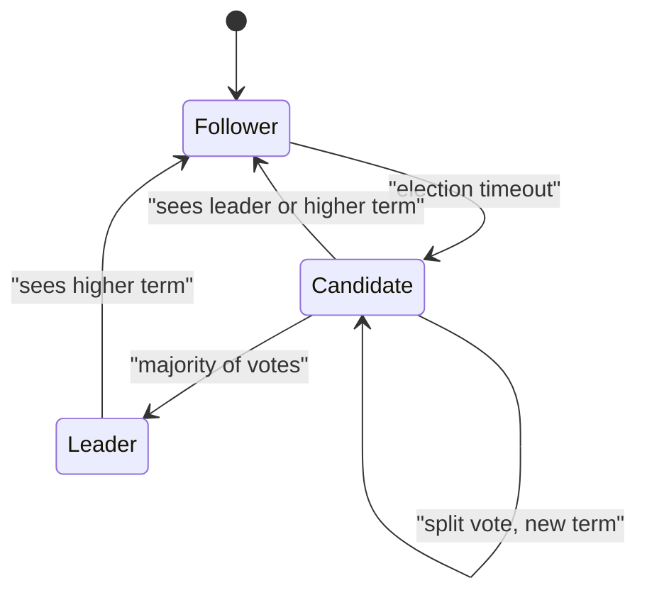

**In simple words:** **Raft** ek consensus algorithm hai jo servers ke group ko commands ke ek ordered log pe agree karata hai, chahe kuch servers crash ho jayein. Ise Paxos se aasan samajhne ke liye design kiya gaya tha. Ye **ek leader** chunta hai jo saare client commands leta hai aur baaki servers ko copy karta hai. Raft sirf crash faults handle karta hai, jhooth bolne wale (Byzantine) nodes nahi. <Cite id="bft-paxos-raft-raft-paper" /> <Cite id="bft-paxos-raft-raft-site" />

**Teen roles:** har server ya to **follower** (passive), **candidate** (votes maang raha) ya **leader** (clients handle karta) hota hai. Time numbered **terms** mein baanta hota hai; har term mein maximum ek leader.

**1. Leader election:**

1. Followers leader se regular **heartbeats** expect karte hain.
2. Agar follower ko random **election timeout** (jaise 150 se 300 ms) tak kuch na mile, to wo candidate ban jaata hai, term badhata hai aur khud ko vote deta hai.
3. Wo doosron se votes maangta hai. Har server ek term mein maximum ek candidate ko vote deta hai.
4. Jis candidate ko **majority** ke votes mile wo leader ban jaata hai aur heartbeats bhejta hai. Random timeout se split votes kam hote hain. <Cite id="bft-paxos-raft-gfg-raft" />

**2. Log replication:**

1. Client leader ko command bhejta hai.
2. Leader use apne log mein append karta hai aur sab followers ko **AppendEntries** bhejta hai.
3. Jab **majority** ne store kar liya, entry **committed** ho jaati hai; leader apply karke client ko jawab deta hai.
4. Followers agle messages mein commit jaante hain aur wo bhi entry apply karte hain.

**3. Safety:** candidate tabhi jeet sakta hai jab uska log voters ke log jitna ya zyada up to date ho, isliye committed entry kabhi lost nahi hoti.

**Example (5 servers S1 se S5):** term 1 mein S1 leader hai.

1. Client "set x = 5" bhejta hai. S1 use append karke S2 se S5 ko bhejta hai. S1, S2 aur S3 store kar lete hain: 5 mein se 3 majority hai, to entry committed ho jaati hai aur client ko "OK" milta hai.
2. S1 crash ho jaata hai. S3 ka election timer pehle khatam hota hai. Wo **term 2** shuru karta hai, khud ko vote deta hai aur baaki se maangta hai. S2, S4 aur S5 yes dete hain, to S3 ke paas 4 votes hain, 3 chahiye the, aur wo leader ban jaata hai.
3. S3 ke paas committed entry "x = 5" hai, to kuch lost nahi hua. S1 restart hone pe term 2 dekhta hai, follower ban jaata hai, aur S3 uska log update kar deta hai.

<Box kind="verify">

$n = 5$ ke liye majority $\lfloor 5/2 \rfloor + 1 = 3$ hai. Raft $\lfloor (5-1)/2 \rfloor = 2$ crashed servers sah sakta hai. Step 2 mein S1 down hai, to S2 se S5 bache: 4 servers, jo 3 se zyada hain, to election safal ho sakta hai. Agar 3 servers crash hote to sirf 2 bachte, majority nahi ban pati, aur cluster inconsistent data ka risk lene ki jagah ruk jaata.

</Box>

**Kahan use hota hai:** etcd, Consul, aur permissioned blockchains jaise Hyperledger Fabric ordering aur Quorum (Raft mode). <Cite id="bft-paxos-raft-wiki-raft" />

**Conclusion:** Raft consensus ko leader election, log replication aur safety mein baant deta hai, jisse crash-tolerant systems ke liye simple aur practical banta hai.

Exam mein English mein likho: "Raft elects a leader, and the leader replicates log entries to followers; an entry is committed when a majority stores it."
