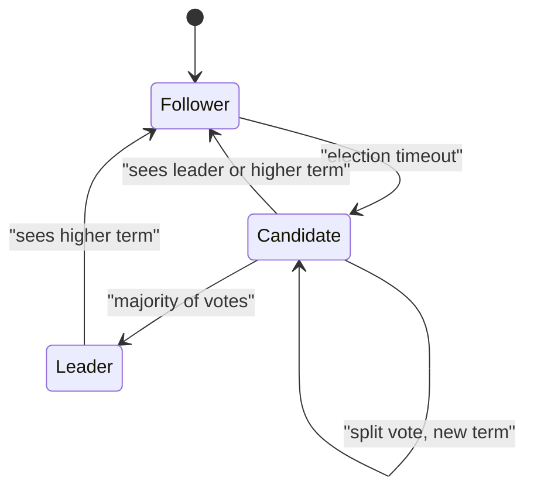

**In simple words:** **Raft** is a consensus algorithm that makes a group of servers agree on one ordered log of commands, even if some servers crash. It was designed to be easier to understand than Paxos. It works by electing **one leader** that accepts all client commands and copies them to the others. Raft handles crash faults only, not lying (Byzantine) nodes. <Cite id="bft-paxos-raft-raft-paper" /> <Cite id="bft-paxos-raft-raft-site" />

**Three roles:** every server is a **follower** (passive), a **candidate** (asking for votes) or the **leader** (handles clients). Time is split into numbered **terms**; each term has at most one leader.

**1. Leader election:**

1. Followers expect regular **heartbeats** from the leader.
2. If a follower hears nothing for a random **election timeout** (for example 150 to 300 ms), it becomes a candidate, increases the term and votes for itself.
3. It asks others for votes. Each server votes for at most one candidate per term.
4. A candidate with votes from a **majority** becomes leader and starts sending heartbeats. The random timeout makes split votes rare. <Cite id="bft-paxos-raft-gfg-raft" />

**2. Log replication:**

1. The client sends a command to the leader.
2. The leader appends it to its own log and sends **AppendEntries** to all followers.
3. Once a **majority** have stored it, the entry is **committed**; the leader applies it and replies to the client.
4. Followers learn the commit in later messages and apply the entry too.

**3. Safety:** a candidate can win only if its log is at least as up to date as the voters' logs, so a committed entry is never lost.

**Example (5 servers S1 to S5):** S1 is leader in term 1.

1. A client sends "set x = 5". S1 appends it and sends it to S2 to S5. S1, S2 and S3 store it: 3 out of 5 is a majority, so the entry is committed and the client gets "OK".
2. S1 crashes. S3's election timer ends first. It starts **term 2**, votes for itself and asks the rest. S2, S4 and S5 vote yes, so S3 has 4 votes, more than the 3 needed, and becomes leader.
3. S3 has the committed entry "x = 5", so nothing is lost. When S1 restarts it sees term 2, becomes a follower, and S3 brings its log up to date.

<Box kind="verify">

For $n = 5$ the majority is $\lfloor 5/2 \rfloor + 1 = 3$. Raft can survive $\lfloor (5-1)/2 \rfloor = 2$ crashed servers. In step 2, S1 is down, so S2 to S5 are left: 4 servers, still at least 3, so an election can succeed. If 3 servers had crashed, only 2 would remain, no majority could form, and the cluster would stop rather than risk inconsistent data.

</Box>

**Used in:** etcd, Consul, and permissioned blockchains such as Hyperledger Fabric ordering and Quorum (Raft mode). <Cite id="bft-paxos-raft-wiki-raft" />

**Conclusion:** Raft splits consensus into leader election, log replication and safety, which makes it simple and practical for crash-tolerant systems.
