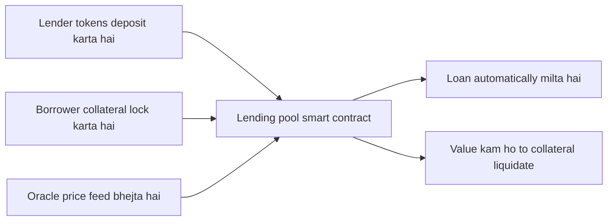

**In simple words:** **DeFi (decentralized finance)** banking jaisi services (lending, trading, saving) blockchain pe **bina bank ya broker** ke deta hai. **Smart contracts** wo programs hain jo bank ka kaam karte hain: paisa hold karte hain, rules lagate hain aur funds automatically move karte hain. <Cite id="smart-contracts-eth-defi" /> <Cite id="smart-contracts-wiki-defi" />

**Smart contract kya hai:** blockchain pe stored code jo conditions poori hone pe bilkul waise hi chalta hai jaisa likha hai, aur koi ek party use badal ya rok nahi sakti. <Cite id="smart-contracts-eth-intro" />

**DeFi mein smart contracts ke roles:**

1. **Lending aur borrowing** (Aave, Compound): lenders pool contract mein tokens deposit karke interest kamate hain. Borrower loan se zyada value ka collateral lock karta hai. Collateral ki value bahut gir jaye to contract use automatically **liquidate** kar deta hai.
2. **Decentralized exchanges (DEX)** (Uniswap): contract do tokens ka pool rakhta hai aur formula se price set karta hai, to users apne wallet se seedha trade karte hain, order book ya company ke bina.
3. **Stablecoins** (DAI): contracts locked collateral ke against coins mint karte hain taaki price 1 dollar ke aaspaas rahe.
4. **Yield farming aur staking:** contracts liquidity dene ya tokens lock karne pe rewards dete hain.
5. **Derivatives aur insurance:** **oracle** se mili condition poori hone pe contract payout automatically trigger karta hai. <Cite id="smart-contracts-eth-oracles" />
6. **Composability:** ek contract doosre ko call kar sakta hai, isliye DeFi apps "money Lego" ki tarah jud jaate hain.

**Benefits:** wallet wale kisi ke liye bhi khula, 24x7 chalta hai, middleman fee nahi, code aur transactions transparent, fast settlement, aur users apne funds ka control rakhte hain.

**Risks:** contract code mein bugs (2016 ke DAO hack mein lagbhag 3.6 million ETH ke funds gaye), oracle manipulation, flash-loan attacks, price volatility, customer support ya deposit insurance nahi, aur regulation unclear. Audits aur tested code risk ghatate hain, hatate nahi. <Cite id="blockchain-applications-ethereum-org-defi" />

| Point | Traditional finance | DeFi |
|---|---|---|
| Kaun chalata hai | Banks, brokers | Smart contracts |
| Access | Account, KYC, working hours | Wallet, hamesha khula |
| Transparency | Private records | Public ledger aur code |
| Custody | Bank funds rakhta hai | User keys rakhta hai |

**Conclusion:** smart contracts trust ko automate karke DeFi possible banate hain: rules code mein hain, to central party nahi chahiye, lekin code sahi hona chahiye.

Exam mein English mein likho: "Smart contracts automate lending, trading and other financial services in DeFi without intermediaries."
