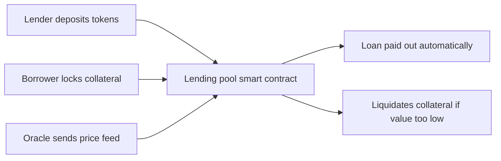

**In simple words:** **DeFi (decentralized finance)** offers banking-style services (lending, trading, saving) on a blockchain **without a bank or broker**. **Smart contracts** are the programs that do the bank's job: they hold the money, apply the rules and move funds automatically. <Cite id="smart-contracts-eth-defi" /> <Cite id="smart-contracts-wiki-defi" />

**What a smart contract is:** code stored on the blockchain that runs exactly as written when its conditions are met, and cannot be changed or stopped by one party. <Cite id="smart-contracts-eth-intro" />

**Roles of smart contracts in DeFi:**

1. **Lending and borrowing** (Aave, Compound): lenders deposit tokens into a pool contract and earn interest. A borrower locks collateral worth more than the loan. If the collateral value falls too low, the contract **liquidates** it automatically.
2. **Decentralized exchanges (DEX)** (Uniswap): a contract holds a pool of two tokens and sets the price by a formula, so users trade directly from their wallets with no order book or company.
3. **Stablecoins** (DAI): contracts mint coins against locked collateral to keep the price near 1 dollar.
4. **Yield farming and staking:** contracts pay rewards for supplying liquidity or locking tokens.
5. **Derivatives and insurance:** payouts are triggered automatically by a contract when a condition, supplied by an **oracle**, is met. <Cite id="smart-contracts-eth-oracles" />
6. **Composability:** one contract can call another, so DeFi apps connect like "money Lego".

**Benefits:** open to anyone with a wallet, works 24x7, no middleman fee, transparent code and transactions, fast settlement, and users keep control of their funds.

**Risks:** bugs in contract code (the 2016 DAO hack lost about 3.6 million ETH of funds), oracle manipulation, flash-loan attacks, price volatility, no customer support or deposit insurance, and unclear regulation. Audits and tested code reduce, but do not remove, the risk. <Cite id="blockchain-applications-ethereum-org-defi" />

| Point | Traditional finance | DeFi |
|---|---|---|
| Who runs it | Banks, brokers | Smart contracts |
| Access | Account, KYC, working hours | Wallet, always open |
| Transparency | Private records | Public ledger and code |
| Custody | Bank holds funds | User holds keys |

**Conclusion:** smart contracts make DeFi possible by automating trust: the rules are in the code, so no central party is needed, but the code must be correct.
