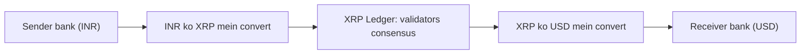

**In simple words:** **Ripple** ek company aur payment network hai jo banks aur payment providers ke beech tez, sasta **cross-border money transfer** ke liye bana hai. Network open **XRP Ledger (XRPL)** pe chalta hai, jiska native token **XRP** hai. <Cite id="corda-ripple-quorum-gfg-ripple" /> <Cite id="corda-ripple-quorum-xrpl-whatis" />

**Kyun zaroori hai:** international bank transfer correspondent banks ki chain (SWIFT) se hote hain, isliye din lagte hain aur har hop pe fees lagti hai. Ripple value ko seedha seconds mein move karne deta hai.

**Main parts:**

1. **XRP Ledger:** public, decentralized ledger jo balances aur payments record karta hai. Settlement lagbhag 3 se 5 seconds mein, aur fees bahut kam.
2. **XRP:** fees ke liye aur **bridge currency** ke roop mein use hone wala token, to INR ko XRP aur phir USD mein turant badal sakte hain bina dono currencies pehle se rakhe.
3. **RippleNet / On-Demand Liquidity (ODL):** wo product jo banks XRP ko bridge banakar paisa bhejne ke liye use karte hain. <Cite id="corda-ripple-quorum-ripple-odl" />
4. **Gateways aur trust lines:** gateway real money ke IOUs issue karta hai, aur users trust lines se unhe hold karte hain.

**Consensus (RPCA):** XRPL mining use nahi karta. Har validator ke paas **Unique Node List (UNL)** hoti hai, un validators ki jo aapas mein collude nahi karenge, aisa bharosa hota hai. Rounds mein validators proposed transaction sets share karte hain, aur sirf wahi transactions rakhte hain jinhe unki UNL ka badhta hissa support karta hai. Jab **UNL ke 80%** agree karte hain, ledger validate ho jaata hai. <Cite id="corda-ripple-quorum-xrpl-consensus" /> <Cite id="corda-ripple-quorum-xrpl-unl" />

**Features:** fast (seconds), low cost, high throughput (lagbhag 1,500 transactions per second), energy efficient (mining nahi), aur 100 billion XRP ki fixed supply, jo sab shuru mein bani.

**Limitations:** Bitcoin se zyada centralised, kyunki UNL aksar recommended list pe based hoti hai, XRP ka bada hissa Ripple ke paas hai, aur US mein XRP ki status ko lekar regulatory action hui hai.

| Point | Bitcoin | Ripple (XRPL) |
|---|---|---|
| Aim | Digital cash | Cross-border payments |
| Consensus | PoW mining | RPCA, UNL voting |
| Confirmation | Lagbhag 10 minutes ya zyada | 3 se 5 seconds |
| Supply | Dheere dheere mine, 21 million cap | 100 billion pehle se bane |

**Conclusion:** Ripple international payments ke slow aur mehnge hisse ko tez consensus ledger aur XRP bridge currency se target karta hai.

Exam mein English mein likho: "Ripple is a real-time gross settlement and remittance network that uses XRP and the XRP Ledger."
