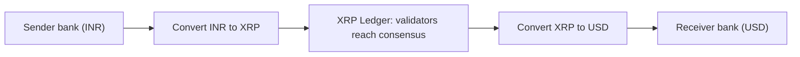

**In simple words:** **Ripple** is a company and a payment network built for fast, cheap **cross-border money transfer** between banks and payment providers. The network runs on the open **XRP Ledger (XRPL)**, whose native token is **XRP**. <Cite id="corda-ripple-quorum-gfg-ripple" /> <Cite id="corda-ripple-quorum-xrpl-whatis" />

**Why it is needed:** international bank transfers use a chain of correspondent banks (SWIFT), so they take days and cost fees at each hop. Ripple lets value move directly in seconds.

**Main parts:**

1. **XRP Ledger:** a public, decentralized ledger that records balances and payments. Settlement takes about 3 to 5 seconds, and fees are tiny.
2. **XRP:** the token used for fees and as a **bridge currency**, so INR can be converted to XRP and then to USD instantly without holding both currencies in advance.
3. **RippleNet / On-Demand Liquidity (ODL):** the product banks use to send money using XRP as the bridge. <Cite id="corda-ripple-quorum-ripple-odl" />
4. **Gateways and trust lines:** a gateway issues IOUs for real money, and users hold them through trust lines.

**Consensus (RPCA):** XRPL does not use mining. Each validator has a **Unique Node List (UNL)** of validators it trusts not to collude. In rounds, validators exchange proposed transaction sets, and keep only transactions that a rising share of their UNL supports. When **80% of the UNL** agree, the ledger is validated. <Cite id="corda-ripple-quorum-xrpl-consensus" /> <Cite id="corda-ripple-quorum-xrpl-unl" />

**Features:** fast (seconds), low cost, high throughput (about 1,500 transactions per second), energy efficient (no mining), and a fixed supply of 100 billion XRP, all created at the start.

**Limitations:** more centralised than Bitcoin since the UNL is often based on a recommended list, a large part of XRP is held by Ripple, and there has been regulatory action in the US about XRP's status.

| Point | Bitcoin | Ripple (XRPL) |
|---|---|---|
| Aim | Digital cash | Cross-border payments |
| Consensus | PoW mining | RPCA with UNL voting |
| Confirmation | About 10 minutes or more | 3 to 5 seconds |
| Supply | Mined gradually, 21 million cap | 100 billion pre-created |

**Conclusion:** Ripple targets the slow, costly part of international payments by using a fast consensus ledger and XRP as a bridge currency.
