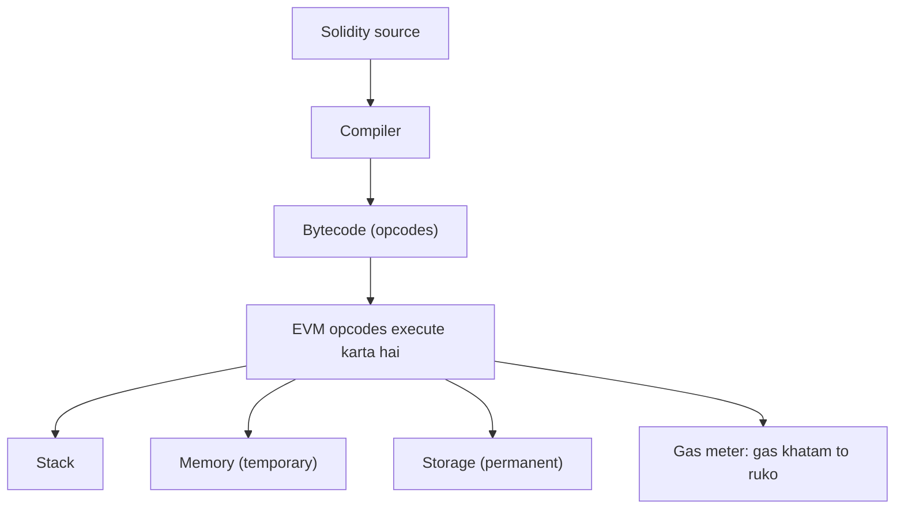

**In simple words:** **Ethereum Virtual Machine (EVM)** har Ethereum node ke andar ka software "computer" hai jo **smart contract code chalata hai**. Har node same input pe same EVM chalata hai, isliye sab nodes same result pe pahunchte hain. <Cite id="ethereum-eth-evm" /> <Cite id="ethereum-gfg-evm" />

**Kyun zaroori hai:** contracts har node pe same tarah chalne chahiye, node ka operating system ya hardware kuch bhi ho. EVM ek common, **sandboxed** environment deta hai, to contract code node ki files ya network ko touch nahi kar sakta.

**Kaise kaam karta hai:**

1. Developer Solidity likhta hai aur use **bytecode** (ADD, SSTORE, CALL jaise **opcodes** ki list) mein compile karta hai.
2. Bytecode blockchain pe ek address par deploy hota hai.
3. Transaction contract ko call karta hai. Har node ka EVM opcodes ek ek karke chalata hai.
4. Har opcode ka **gas** cost hota hai. Gas khatam hone pe execution ruk jaata hai aur uske saare state changes revert ho jaate hain. <Cite id="ethereum-eth-gas" />
5. Safal hone pe nayi state (balances, contract storage) world state mein save hoti hai.

**EVM ke parts:**

- **Stack:** 256-bit words ka last-in first-out stack, maximum 1024 items; opcodes isi pe kaam karte hain.
- **Memory:** temporary byte array jo har call ke baad clear hota hai.
- **Storage:** har contract ka permanent key-value store, blockchain pe saved. Isme likhna sabse mehnga hai.
- **Calldata:** call ka read-only input.
- **Program counter aur gas counter:** agla instruction kaun sa hai, aur kitna gas bacha hai.

**Features:** deterministic (same input, same output), Turing-complete lekin gas se bounded, host machine se isolated, aur quasi-universal: doosri chains (Polygon, BNB Chain, Avalanche C-Chain) EVM-compatible hain, to wahi contract wahan bhi chalta hai.

**Limitations:** normal computers se slow, storage mehnga, aur chhota word size aur stack limit.

**Conclusion:** EVM Ethereum ka execution engine hai: contract bytecode aur gas ko safe, har jagah same computation mein badalta hai.

Exam mein English mein likho: "The EVM is a sandboxed, deterministic virtual machine that executes smart contract bytecode on every Ethereum node."
