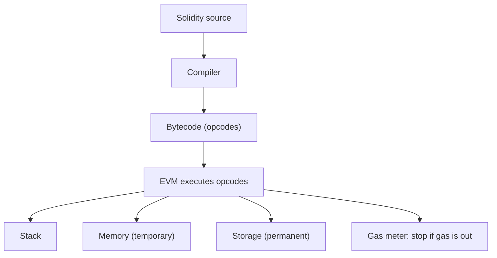

**In simple words:** the **Ethereum Virtual Machine (EVM)** is the software "computer" inside every Ethereum node that **runs smart contract code**. Every node runs the same EVM on the same input, so all nodes reach the same result. <Cite id="ethereum-eth-evm" /> <Cite id="ethereum-gfg-evm" />

**Why it is needed:** contracts must run the same way on every node, whatever the node's operating system or hardware. The EVM gives one common, **sandboxed** environment, so contract code cannot touch the node's files or network.

**How it works:**

1. A developer writes Solidity and compiles it to **bytecode** (a list of **opcodes** such as ADD, SSTORE, CALL).
2. The bytecode is deployed to an address on the blockchain.
3. A transaction calls the contract. Each node's EVM executes the opcodes one by one.
4. Each opcode costs **gas**. If the gas runs out, execution stops and all its state changes are reverted. <Cite id="ethereum-eth-gas" />
5. If it succeeds, the new state (balances, contract storage) is saved to the world state.

**Parts of the EVM:**

- **Stack:** 256-bit-word last-in first-out stack, up to 1024 items; opcodes work on it.
- **Memory:** temporary byte array that is cleared after each call.
- **Storage:** permanent key-value store of each contract, saved on the blockchain. It is the most expensive to write.
- **Calldata:** read-only input of the call.
- **Program counter and gas counter:** which instruction is next, and how much gas is left.

**Features:** deterministic (same input, same output), Turing-complete but bounded by gas, isolated from the host machine, and quasi-universal: other chains (Polygon, BNB Chain, Avalanche C-Chain) are EVM-compatible so the same contract runs there.

**Limitations:** slow compared to normal computers, costly storage, and a small word size and stack limit.

**Conclusion:** the EVM is the execution engine of Ethereum: it turns contract bytecode and gas into a safe, same-everywhere computation.
