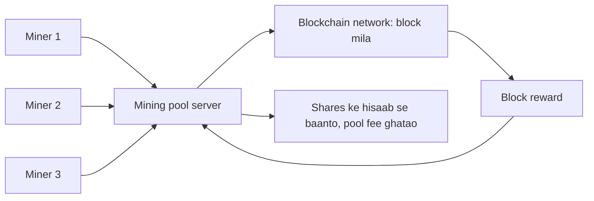

**In simple words:** **mining pool** miners ka group hai jo apni computing power jodta hai aur **reward share karta hai**, har miner ke kaam ke hisaab se. Akele mining karna ek lottery ticket kharidne jaisa hai; pool kai doston ka milkar tickets kharidna aur prize baantna hai. <Cite id="consensus-mining-wiki-pool" /> <Cite id="consensus-mining-btcwiki-pooled" />

**Kyun zaroori hai:** total hash power badhne se chhote solo miner ko block dhoondhne mein saalon lag sakte hain, to income bahut uncertain hai. Pool chhote, steady payouts deta hai.

**Kaise kaam karta hai:**

1. Miners pool server se connect hote hain aur server har ek ko kaam ke liye block template deta hai.
2. Miners hash karte hain aur **shares** bhejte hain: aise hashes jo poore target ke liye kaafi nahi hain lekin pool ke easier target ko meet karte hain. Shares prove karte hain ki kisne kitna kaam kiya.
3. Agar koi miner real network target meet karne wala hash dhoondh le, to pool block submit karta hai aur block reward aur fees paata hai.
4. Pool operator apni fee (aksar 1 se 3%) kaat ke baaki shares ke hisaab se baantta hai. <Cite id="bitcoin-mb-ch12-mining" />

**Reward baantne ke methods:**

| Method | Kaise pay karta hai | Pros | Cons |
|---|---|---|---|
| Proportional | Block milne pe reward us round ke shares ke hisaab se baanta jaata hai | Simple, fair | Luck pe depend, pool-hopping possible |
| PPS (Pay Per Share) | Har share ka fixed payment, turant | Steady income, miner ko luck ka risk nahi | Risk operator ka, to fee zyada |
| PPLNS (Pay Per Last N Shares) | Block reward last N shares pe baanta jaata hai, sirf current round pe nahi | Pool-hopping rokta hai, loyal miners ko reward | Payout luck pe depend |
| FPPS | PPS plus transaction fees ka hissa | Steady aur fees included | Pool fee zyada |

**Example:** 1000 miners ke pool ke paas network hash rate ka 1% ho to wo saare blocks ka lagbhag 1% dhoondhta hai, yaani 10 minute per block pe lagbhag 1000 minute (~17 ghante) mein 1 block. Pool ki power ka 0.1% rakhne wale miner ko har aise reward ka 0.1% regular milta hai.

**Advantages:** steady income, kam variance, chhote miners ko hissa lene deta hai. **Disadvantages:** pool fee, operator pe trust, aur **centralisation risk**: agar ek pool 50% hash power paar kare to 51% attack try kar sakta hai, isliye miners ko failne ke liye protsahit kiya jaata hai.

**Conclusion:** pools thodi fee aur kuch centralisation dekar stable, predictable mining income dete hain.

Exam mein English mein likho: "A mining pool combines the hash power of many miners and shares the reward according to the work done."
