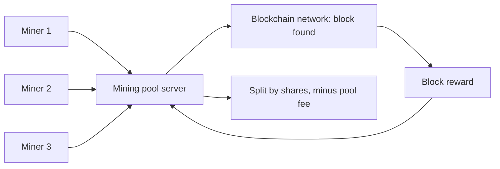

**In simple words:** a **mining pool** is a group of miners who combine their computing power and **share the reward** in proportion to the work each did. Mining alone is like buying a single lottery ticket; a pool is like many friends buying tickets together and splitting any prize. <Cite id="consensus-mining-wiki-pool" /> <Cite id="consensus-mining-btcwiki-pooled" />

**Why it is needed:** as total hash power grew, a small solo miner may wait years to find a block, so income is very uncertain. A pool gives small, steady payouts.

**How it works:**

1. Miners connect to a pool server and the server gives each a block template to work on.
2. Miners hash and send **shares**: hashes that are not good enough for the full target but meet an easier pool target. Shares prove how much work each miner did.
3. If any miner finds a hash that meets the real network target, the pool submits the block and receives the block reward and fees.
4. The pool operator deducts a fee (often 1 to 3%) and divides the rest by the shares. <Cite id="bitcoin-mb-ch12-mining" />

**Reward-sharing methods:**

| Method | How it pays | Pros | Cons |
|---|---|---|---|
| Proportional | When a block is found, reward is split by shares in that round | Simple, fair | Luck-based, pool-hopping is possible |
| PPS (Pay Per Share) | Fixed payment for each share, immediately | Steady income, no luck risk for miner | Operator takes the risk, so higher fee |
| PPLNS (Pay Per Last N Shares) | Block reward split over the last N shares, not only the current round | Discourages pool-hopping, rewards loyal miners | Payout depends on luck |
| FPPS | PPS plus a share of transaction fees | Steady and includes fees | Higher pool fee |

**Example:** if a pool of 1000 miners has 1% of the network hash rate, it finds about 1% of all blocks, about 1 block per 1000 minutes (~17 hours) at 10 minutes per block. A miner with 0.1% of the pool's power then gets 0.1% of every such reward, regularly.

**Advantages:** steady income, low variance, lets small miners take part. **Disadvantages:** pool fee, trust in the operator, and **centralisation risk**: if one pool crosses 50% of hash power it could attempt a 51% attack, so miners are encouraged to spread out.

**Conclusion:** pools trade a small fee and some centralisation for stable, predictable mining income.
