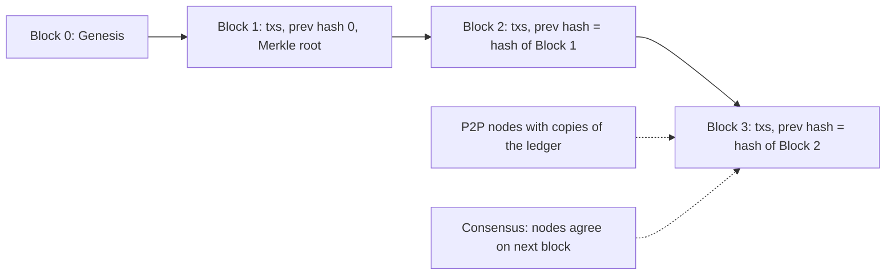

**In simple words:** blockchain ek shared digital ledger hai jo bahut saare computers rakhte hain. Ye kuch parts se bana hai jo saath mein kaam karte hain. <Cite id="blockchain-fundamentals-ibm-blockchain" />

**Components:**

1. **Node:** koi bhi computer jo ledger ki copy rakhta hai aur rules follow karta hai. Full nodes sab check karte hain; light nodes sirf headers rakhte hain.
2. **Transaction:** basic record, jaise "A pays B 2 coins". Ise sender sign karta hai.
3. **Block:** transactions ka group plus ek header. Header mein previous block hash, Merkle root, timestamp aur nonce hota hai. <Cite id="blockchain-fundamentals-gfg-structure" />
4. **Chain:** har block pichle block ka hash store karta hai, isliye purana block badlo to uske baad ke saare blocks toot jaate hain.
5. **Cryptography:** hash functions (SHA-256) fingerprints dete hain; digital signatures (public aur private keys) prove karte hain ki transaction kisne bheja.
6. **Distributed ledger (P2P network):** har node ek copy rakhta hai; koi central server nahi.
7. **Consensus mechanism:** wo rule jisse nodes agle block pe agree karte hain, jaise Proof of Work ya Proof of Stake. <Cite id="blockchain-fundamentals-nakamoto" />
8. **Smart contracts (kuch chains mein):** chain pe programs jo automatically chalte hain.

**Conclusion:** nodes, transactions, blocks, hashing, signatures aur consensus milkar aisa ledger banate hain jise koi ek party control nahi karti. <Cite id="blockchain-fundamentals-tp-intro" />

Exam mein English mein likho: "The components of a blockchain are nodes, transactions, blocks, hashing, digital signatures and a consensus mechanism."
