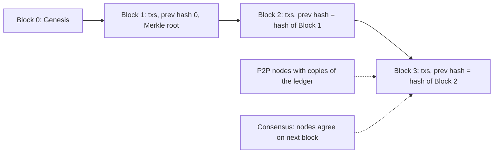

**In simple words:** a blockchain is a shared digital ledger kept by many computers. It is built from a few parts that work together. <Cite id="blockchain-fundamentals-ibm-blockchain" />

**Components:**

1. **Node:** any computer that holds a copy of the ledger and follows the rules. Full nodes check everything; light nodes keep only headers.
2. **Transaction:** the basic record, such as "A pays B 2 coins". It is signed by the sender.
3. **Block:** a group of transactions plus a header. The header has the previous block hash, Merkle root, timestamp and nonce. <Cite id="blockchain-fundamentals-gfg-structure" />
4. **Chain:** each block stores the hash of the one before, so changing an old block breaks every block after it.
5. **Cryptography:** hash functions (SHA-256) give fingerprints; digital signatures (public and private keys) prove who sent a transaction.
6. **Distributed ledger (P2P network):** every node keeps a copy; there is no central server.
7. **Consensus mechanism:** the rule by which nodes agree on the next block, such as Proof of Work or Proof of Stake. <Cite id="blockchain-fundamentals-nakamoto" />
8. **Smart contracts (in some chains):** programs on the chain that run automatically.

**Conclusion:** nodes, transactions, blocks, hashing, signatures and consensus together make a ledger that no single party controls. <Cite id="blockchain-fundamentals-tp-intro" />
