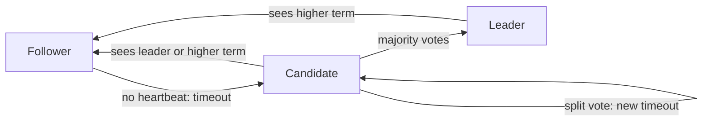

**In simple words:** Raft ek consensus algorithm hai jo servers ke group ko same log (commands ki list) rakhne deta hai, chahe kuch servers crash ho jaayein. Ise Ongaro aur Ousterhout (2014) ne Paxos se aasaan banane ke liye design kiya. Ek server **leader** hota hai; baaki uske peeche chalte hain. <Cite id="bft-paxos-raft-raft-paper" />

**Why it is needed:** kai servers ko commands ke same order pe agree karna hota hai, chahe servers fail ho jaayein ya messages late aayein. Raft sirf crash faults handle karta hai, jhooth bolne wale (Byzantine) nodes nahi.

**Server states:** har server **Follower**, **Candidate** ya **Leader** hota hai. Time ko **terms** (numbered periods) mein kaata jaata hai; har term mein zyada se zyada ek leader hota hai.

**How it works:**

1. **Leader election.** Har follower ka ek random election timer hota hai (lagbhag 150 se 300 ms). Leader se heartbeat na mile to wo candidate ban jaata hai, term badhata hai, khud ko vote deta hai aur baaki se votes maangta hai.
2. Jo candidate **majority** se votes paata hai wo leader ban jaata hai. Har server ek term mein ek hi vote deta hai, isliye sirf ek leader hota hai. Votes split ho jaayein to naya random timeout dobara try karwata hai.
3. **Heartbeats.** Leader regular khaali messages bhejta hai taaki followers jaanein ki wo zinda hai.
4. **Log replication.** Client leader ko command bhejta hai. Leader use apne log mein add karta hai aur followers ko bhejta hai (AppendEntries).
5. **Commit.** Jab majority entry store kar leti hai, leader use commit karta hai, chalata hai, client ko reply deta hai, aur followers ko bhi commit karne ko kehta hai.
6. **Safety.** Out-of-date log wala candidate jeet nahi sakta, isliye committed entries kabhi nahi khoti. <Cite id="bft-paxos-raft-raft-site" />

**Fault tolerance:** 2f+1 servers ka cluster f crashes survive karta hai (3 servers 1 ko, 5 servers 2 ko).

**Advantages:** samajhne mein aasaan, strong leader, widely used (etcd, Consul). **Limits:** saari writes ek leader se jaati hain; malicious nodes tolerate nahi karta. Hyperledger Fabric aur Quorum private chains ke liye Raft ordering dete hain. <Cite id="bft-paxos-raft-gfg-raft" />

**Conclusion:** Raft leader chunta hai, uska log majority ko copy karta hai aur is tarah saare servers consistent rakhta hai. <Cite id="bft-paxos-raft-wiki-raft" />

Exam mein English mein likho: "Raft elects a leader, replicates its log to a majority of servers and commits an entry once a majority has stored it."
