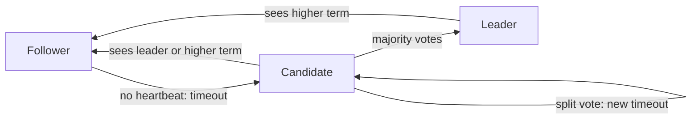

**In simple words:** Raft is a consensus algorithm that lets a group of servers keep the same log (list of commands) even if some servers crash. It was designed by Ongaro and Ousterhout (2014) to be easier to understand than Paxos. One server is the **leader**; the others follow it. <Cite id="bft-paxos-raft-raft-paper" />

**Why it is needed:** many servers must agree on the same order of commands, even when servers fail or messages are late. Raft handles crash faults only, not lying (Byzantine) nodes.

**Server states:** every server is a **Follower**, **Candidate** or **Leader**. Time is cut into **terms** (numbered periods); each term has at most one leader.

**How it works:**

1. **Leader election.** Every follower has a random election timer (about 150 to 300 ms). If it hears no heartbeat from a leader, it becomes a candidate, increases the term, votes for itself and asks the others for votes.
2. A candidate that gets votes from a **majority** becomes leader. Each server votes once per term, so there is only one leader. If votes split, a new random timeout makes another try.
3. **Heartbeats.** The leader sends regular empty messages so followers know it is alive.
4. **Log replication.** A client sends a command to the leader. The leader appends it to its log and sends it to the followers (AppendEntries).
5. **Commit.** When a majority have stored the entry, the leader commits it, runs it, replies to the client, and tells followers to commit too.
6. **Safety.** A candidate with an out-of-date log cannot win, so committed entries are never lost. <Cite id="bft-paxos-raft-raft-site" />

**Fault tolerance:** a cluster of 2f+1 servers survives f crashes (3 servers survive 1, 5 survive 2).

**Advantages:** easy to understand, strong leader, widely used (etcd, Consul). **Limits:** all writes go through one leader; it does not tolerate malicious nodes. Hyperledger Fabric and Quorum offer Raft ordering for private chains. <Cite id="bft-paxos-raft-gfg-raft" />

**Conclusion:** Raft elects a leader, copies its log to a majority and so keeps all servers consistent. <Cite id="bft-paxos-raft-wiki-raft" />
