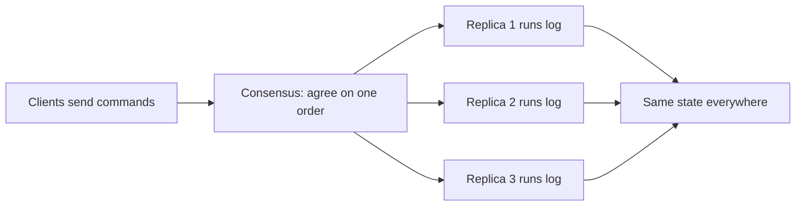

**In simple words:** state machine replication (SMR) ka matlab hai same program kai servers pe chalana, har server ko same commands same order mein dena, taaki sab hamesha same state mein rahein. Ek server fail ho jaaye to baaki chalte rehte hain. <Cite id="smart-contracts-wiki-smr" />

**State machine:** ek program jiski ek state hai (jaise account balances) aur wo sirf commands chala ke use badalta hai. Agar wo **deterministic** hai, to same state plus same command hamesha same nayi state deta hai.

**How it works:**

1. Saare replicas ko same initial state pe start karo.
2. Clients commands (transactions) bhejte hain.
3. Ek **consensus algorithm** (Paxos, Raft, PBFT) saare replicas ko commands ke ek **order** pe agree karata hai.
4. Har replica commands ko usi order mein chalata hai.
5. Saare replicas same state pe pahunchte hain aur same replies dete hain.

**Fault tolerance:** crash faults ke liye 2f+1 replicas chahiye (Paxos, Raft); Byzantine faults ke liye 3f+1 (PBFT). <Cite id="smart-contracts-schneider-1990" />

**Blockchain link:** blockchain ek SMR system hai. Ledger state hai, transactions commands hain, consensus (PoW, PoS, PBFT) order deta hai, aur har node same transactions chalata hai. Ethereum mein EVM state machine hai, aur smart contracts isi wajah se deterministic hone chahiye.

**Real use:** Google Chubby, etcd aur Hyperledger Fabric ordering. <Cite id="bft-paxos-raft-wiki-consensus" />

**Conclusion:** SMR plus consensus ek aisi service deta hai jo kuch replicas fail hone par bhi sahi aur available rehti hai. <Cite id="bft-paxos-raft-raft-paper" />

Exam mein English mein likho: "State machine replication keeps many servers in the same state by applying the same commands in the same order."
