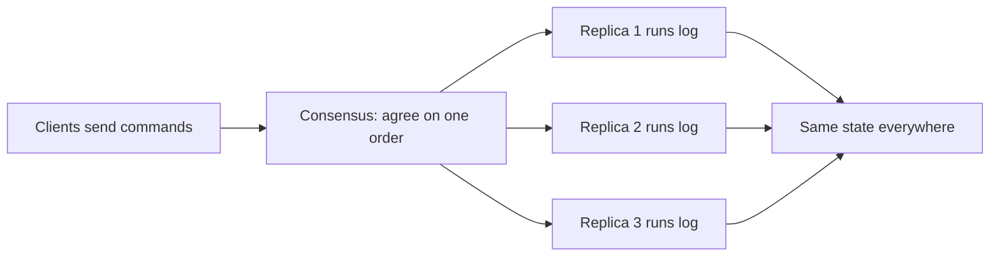

**In simple words:** state machine replication (SMR) means running the same program on many servers, giving every server the same commands in the same order, so all of them always have the same state. If one server fails, the others carry on. <Cite id="smart-contracts-wiki-smr" />

**State machine:** a program that has a state (for example account balances) and changes it only by running commands. If it is **deterministic**, the same state plus the same command always gives the same new state.

**How it works:**

1. Start all replicas in the same initial state.
2. Clients send commands (transactions).
3. A **consensus algorithm** (Paxos, Raft, PBFT) makes all replicas agree on one **order** of commands.
4. Each replica runs the commands in that order.
5. All replicas reach the same state and give the same replies.

**Fault tolerance:** crash faults need 2f+1 replicas (Paxos, Raft); Byzantine faults need 3f+1 (PBFT). <Cite id="smart-contracts-schneider-1990" />

**Blockchain link:** a blockchain is an SMR system. The ledger is the state, transactions are commands, consensus (PoW, PoS, PBFT) gives the order, and every node runs the same transactions. In Ethereum the EVM is the state machine, and smart contracts must be deterministic for this reason.

**Real use:** Google Chubby, etcd and Hyperledger Fabric ordering. <Cite id="bft-paxos-raft-wiki-consensus" />

**Conclusion:** SMR plus consensus gives a service that stays correct and available even when some replicas fail. <Cite id="bft-paxos-raft-raft-paper" />
