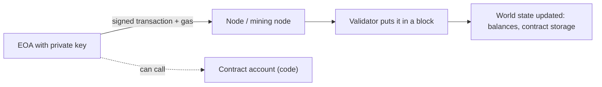

**In simple words:** Ethereum ek blockchain hai jo programs chalata hai. Neeche ke paanch terms batate hain ki kaun kaam karta hai, kitna kharch lagta hai, kiske paas kya hai, aur cheezein kaise badalti hain. <Cite id="ethereum-eth-ether" />

**1. Miner and mining node.** **Miner** wo person ya machine hai jo transactions collect karke block mein pack karta hai aur reward kamata hai. **Mining node** wo computer hai jo ye kaam karta hai: Ethereum client chalata hai, transactions validate karta hai aur agla block add karne ki race mein hota hai. Ethereum ne September 2022 tak Proof of Work mining use ki; Merge ke baad miners ki jagah **validators** aaye jo 32 ETH stake karte hain. <Cite id="ethereum-eth-mining" />

**2. Gas.** Gas ek unit hai jo kisi operation ka computing work napta hai. Simple ETH transfer 21,000 gas use karta hai; contract code zyada. Fee = gas used $\times$ gas price. Gas infinite loops rokta hai aur network ko uske kaam ka payment deta hai. Sender gas limit set karta hai; agar gas khatam ho jaye to transaction fail ho jaata hai aur fee phir bhi lagti hai. <Cite id="ethereum-eth-gas" />

<Sum>

<Given>

Plain ETH transfer 21,000 gas use karta hai. Gas price 20 gwei hai (1 gwei $= 10^{-9}$ ETH).

</Given>

<Find>

ETH mein fee.

</Find>

<Steps>

1. Fee = gas used $\times$ gas price $= 21{,}000 \times 20 = 420{,}000$ gwei. *Reason: fee gas ko price per gas se multiply karke aati hai.*
2. Convert: $420{,}000 \times 10^{-9} = 0.00042$ ETH. *Reason: 1 gwei ETH ka ek arabwaan hissa hai.*

</Steps>

<Answer>

0.00042 ETH

</Answer>

<Box kind="verify">

Ulta: $0.00042 / 21{,}000 = 2 \times 10^{-8}$ ETH $= 20$ gwei per gas, wahi price jisse humne shuru kiya tha.

</Box>

</Sum>

**3. Accounts.** Account mein balance hota hai aur ek address. Do kism ke hote hain: **Externally Owned Accounts (EOA)**, jo private key se control hote hain aur transactions shuru kar sakte hain; aur **Contract accounts**, jo code se control hote hain aur sirf call hone par chalte hain. Har account nonce, balance aur (contracts ke liye) code aur storage rakhta hai. <Cite id="ethereum-eth-accounts" />

**4. Ether (ETH).** Ethereum ka native coin. Isse gas fees di jaati hain, stake kiya jaata hai, aur paise ki tarah use hota hai. Sabse chhota unit wei hai (1 ETH $= 10^{18}$ wei).

**5. Transactions.** Transaction EOA ka signed message hai jo state badalta hai: ETH bhejna, contract deploy karna ya contract function call karna. Isme recipient, value, data, gas limit, gas price (fee), nonce aur signature hote hain. Nonce replay rokta hai. <Cite id="ethereum-eth-transactions" />

**Conclusion:** miners ya validators chain ko secure karte hain, gas kaam ki keemat tay karta hai, accounts value rakhte hain, ether payment karta hai, aur transactions state badalte hain. <Cite id="ethereum-gfg-accounts" />

Exam mein English mein likho: "Gas measures computation; fee equals gas used multiplied by gas price."
