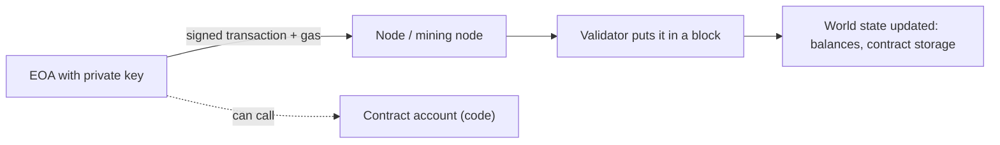

**In simple words:** Ethereum is a blockchain that runs programs. The five terms below describe who works on it, what it costs, who owns what, and how things change. <Cite id="ethereum-eth-ether" />

**1. Miner and mining node.** A **miner** is a person or machine that collects transactions, packs them into a block and earns a reward. A **mining node** is the computer that does this work: it runs an Ethereum client, validates transactions and competes to add the next block. Ethereum used Proof of Work mining until September 2022; after the Merge, miners were replaced by **validators** who stake 32 ETH. <Cite id="ethereum-eth-mining" />

**2. Gas.** Gas is the unit that measures the computing work of an operation. A simple ETH transfer uses 21,000 gas; contract code uses more. The fee is gas used $\times$ gas price. Gas stops infinite loops and pays the network for its work. A sender sets a gas limit; if it runs out, the transaction fails and the fee is still paid. <Cite id="ethereum-eth-gas" />

<Sum>

<Given>

A plain ETH transfer uses 21,000 gas. The gas price is 20 gwei (1 gwei $= 10^{-9}$ ETH).

</Given>

<Find>

the fee in ETH.

</Find>

<Steps>

1. Fee = gas used $\times$ gas price = $21{,}000 \times 20 = 420{,}000$ gwei. *Reason: the fee is gas times price per gas.*
2. Convert: $420{,}000 \times 10^{-9} = 0.00042$ ETH. *Reason: 1 gwei is a billionth of an ETH.*

</Steps>

<Answer>

0.00042 ETH

</Answer>

<Box kind="verify">

Reverse: $0.00042 / 21{,}000 = 2 \times 10^{-8}$ ETH $= 20$ gwei per gas, the price we started with.

</Box>

</Sum>

**3. Accounts.** An account holds a balance and has an address. There are two kinds: **Externally Owned Accounts (EOA)**, controlled by a private key, which can start transactions; and **Contract accounts**, controlled by code, which run only when called. Each account stores a nonce, balance and (for contracts) code and storage. <Cite id="ethereum-eth-accounts" />

**4. Ether (ETH).** The native coin of Ethereum. It is used to pay gas fees, to stake, and as money. The smallest unit is wei (1 ETH $= 10^{18}$ wei).

**5. Transactions.** A transaction is a signed message from an EOA that changes the state: sending ETH, deploying a contract or calling a contract function. It contains recipient, value, data, gas limit, gas price (fee), nonce and signature. The nonce stops replay. <Cite id="ethereum-eth-transactions" />

**Conclusion:** miners or validators secure the chain, gas prices the work, accounts hold value, ether pays, and transactions change the state. <Cite id="ethereum-gfg-accounts" />
