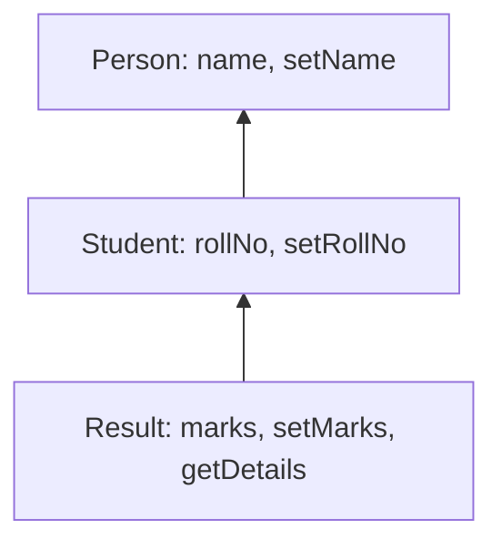

**In simple words:** **multi-level inheritance** mein ek contract parent se inherit karta hai, aur wo parent apne parent se, jaise grandparent, parent aur child. Sabse last wale child ko apne upar ke dono levels se sab kuch milta hai. Solidity mein ye keyword `is` se hota hai. <Cite id="solidity-docs-inheritance" />

```solidity
// SPDX-License-Identifier: MIT
pragma solidity ^0.8.0;

// Level 1: grandparent
contract Person {
    string public name;

    function setName(string memory _name) public {
        name = _name;
    }
}

// Level 2: child of Person
contract Student is Person {
    uint public rollNo;

    function setRollNo(uint _rollNo) public {
        rollNo = _rollNo;
    }
}

// Level 3: child of Student, so grandchild of Person
contract Result is Student {
    uint public marks;

    function setMarks(uint _marks) public {
        marks = _marks;
    }

    function getDetails() public view returns (string memory, uint, uint) {
        return (name, rollNo, marks);
    }
}
```

**Line by line:**

- `SPDX-License-Identifier` licence ka label hai; `pragma solidity ^0.8.0` kehta hai ki code ko compiler 0.8.0 ya naya 0.8.x chahiye.
- `contract Person` base contract hai. Isme state variable `name` hai (public, isliye Solidity getter bana deta hai) aur value store karne ke liye `setName`. `memory` ka matlab string ek temporary copy hai.
- `contract Student is Person` Person se inherit karta hai, isliye iske paas pehle se `name` aur `setName` hai. Ye `rollNo` aur `setRollNo` add karta hai. Ye level 2 hai.
- `contract Result is Student` Student se inherit karta hai, aur uske through Person se. Ye `marks` aur `setMarks` add karta hai. Ye level 3 hai.
- `getDetails` `name`, `rollNo` aur `marks` padhta hai (pehle do parents se aate hain) aur teeno return karta hai. Ye `view` hai kyunki sirf data padhta hai.
- Sirf `Result` deploy karo: usmein teeno contracts ke functions hote hain. <Cite id="solidity-gfg-inheritance" />

<Box kind="verify">

`Result` deploy karo aur call karo: `setName("Asha")`, `setRollNo(7)`, `setMarks(85)`. Phir `getDetails()` `("Asha", 7, 85)` return karta hai. `name` Person se aaya, `rollNo` Student se, `marks` Result se, to ek object mein teeno levels hain. Maine ye code solc 0.8.26 se compile kiya, koi errors ya warnings nahi aaye.

</Box>



**Conclusion:** multi-level inheritance se har level apni features add karta hai aur upar ke levels ka code reuse karta hai. <Cite id="solidity-tp-inheritance" />

Exam mein English mein likho: "In multi-level inheritance, a derived contract acts as the base of another contract."
