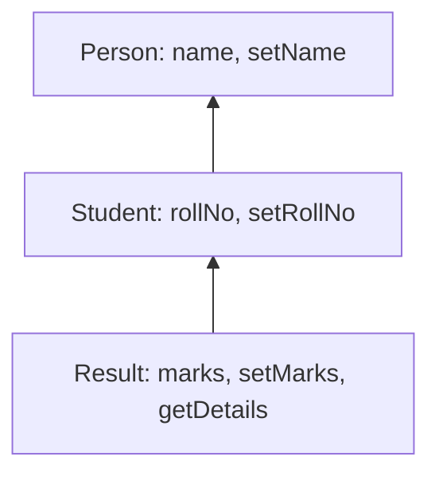

**In simple words:** in **multi-level inheritance** a contract inherits from a parent, and that parent inherits from its own parent, like grandparent, parent and child. The last child gets everything from both levels above it. In Solidity this is done with the keyword `is`. <Cite id="solidity-docs-inheritance" />

```solidity
// SPDX-License-Identifier: MIT
pragma solidity ^0.8.0;

// Level 1: grandparent
contract Person {
    string public name;

    function setName(string memory _name) public {
        name = _name;
    }
}

// Level 2: child of Person
contract Student is Person {
    uint public rollNo;

    function setRollNo(uint _rollNo) public {
        rollNo = _rollNo;
    }
}

// Level 3: child of Student, so grandchild of Person
contract Result is Student {
    uint public marks;

    function setMarks(uint _marks) public {
        marks = _marks;
    }

    function getDetails() public view returns (string memory, uint, uint) {
        return (name, rollNo, marks);
    }
}
```

**Line by line:**

- `SPDX-License-Identifier` is the licence label; `pragma solidity ^0.8.0` says the code needs compiler 0.8.0 or a newer 0.8.x.
- `contract Person` is the base contract. It has a state variable `name` (public, so Solidity makes a getter for it) and `setName` to store a value. `memory` means the string is a temporary copy.
- `contract Student is Person` inherits from Person, so it already has `name` and `setName`. It adds `rollNo` and `setRollNo`. This is level 2.
- `contract Result is Student` inherits from Student, and through it from Person. It adds `marks` and `setMarks`. This is level 3.
- `getDetails` reads `name`, `rollNo` and `marks` (the first two come from the parents) and returns all three. It is `view` because it only reads data.
- Deploy only `Result`: it holds the functions of all three contracts. <Cite id="solidity-gfg-inheritance" />

<Box kind="verify">

Deploy `Result` and call: `setName("Asha")`, `setRollNo(7)`, `setMarks(85)`. Then `getDetails()` returns `("Asha", 7, 85)`. `name` came from Person, `rollNo` from Student, `marks` from Result itself, so one object has all three levels. I compiled this code with solc 0.8.26 and it gave no errors or warnings.

</Box>



**Conclusion:** multi-level inheritance lets each level add its own features and reuse the code of the levels above. <Cite id="solidity-tp-inheritance" />
