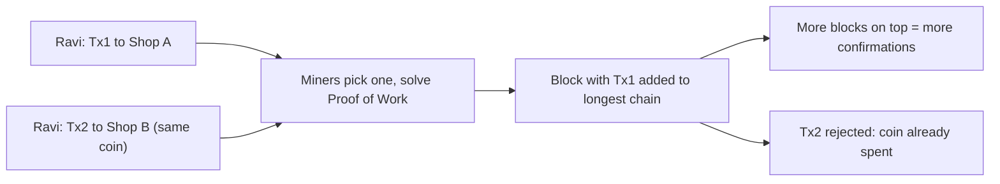

**In simple words:** double spending ka matlab hai ek hi digital coin ko do baar kharch karna. Digital files copy ho sakti hain, isliye bina check ke koi ek hi coin se do dukaano ko pay kar sakta hai. Cash mein ye problem nahi, kyunki haath se nikalte hi wo chala jaata hai. <Cite id="wallets-utxo-double-spending-gfg-double-spending" />

**Why it is a problem:** normally bank ek ledger rakhta hai aur doosra payment reject kar deta hai. Bitcoin mein bank nahi hai, isliye network ko khud decide karna padta hai ki do conflicting transactions mein se asli kaun sa hai. <Cite id="blockchain-fundamentals-nakamoto" loc="Abstract" />

**Example:** Ravi ke paas 1 coin hai. Wo use Shop A ko bhejta hai (Tx1) aur usi samay wahi coin Shop B ko bhi bhejta hai (Tx2). Sirf ek valid ho sakta hai.

**Algorithm jo ise solve karta hai: Proof of Work (longest-chain rule ke saath).**

1. Har node ledger ki poori copy rakhta hai aur aisi transaction reject karta hai jo already-spent coin kharch kare.
2. Transactions pool mein wait karte hain. Miners transactions chun ke block banate hain; agar Tx1 aur Tx2 dono hain, to miner sirf ek leta hai.
3. Miners hash puzzle solve karne ki race lagate hain. Jo pehle solve kare wo block broadcast karta hai.
4. Baaki nodes block verify karke add karte hain aur uske upar mining karte hain. Usmein ka transaction ab confirmed hai.
5. Tx2 ab chain mein pehle se kharch hua coin kharch kar raha hai, isliye har node use reject karta hai.
6. Agar do blocks saath aa jaayein (fork), nodes **longest chain** follow karte hain; chhoti branch drop ho jaati hai aur uske transactions wapas pool mein aate hain.
7. Upar ka har naya block ek aur **confirmation** hai. Tx1 ko ulatne ke liye attacker ko baad ke saare blocks ka kaam dobara karna padega aur honest network se aage nikalna padega, jiske liye 50% se zyada hash power chahiye (51% attack). Lagbhag 6 confirmations ke baad safe maana jaata hai. <Cite id="wallets-utxo-double-spending-btcwiki-double-spending" />

**Other ways it can be attempted:** race attack (do tez transactions), Finney attack (pre-mined block) aur 51% attack. Confirmations ka wait in sab se bachata hai.

**Conclusion:** Proof of Work, UTXO check aur longest-chain rule ke saath, double spending ko bahut costly bana deta hai, isliye ajnabi bina bank ke ledger pe trust kar sakte hain. <Cite id="consensus-mining-gfg-pow" />

Exam mein English mein likho: "Double spending is spending the same coin twice; Proof of Work and the longest-chain rule prevent it."
