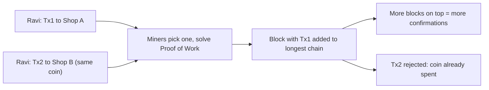

**In simple words:** double spending means spending the same digital coin twice. Digital files can be copied, so without a check a person could pay two shops with the same coin. Cash does not have this problem, because once you hand it over it is gone. <Cite id="wallets-utxo-double-spending-gfg-double-spending" />

**Why it is a problem:** normally a bank keeps one ledger and rejects the second payment. Bitcoin has no bank, so the network itself must decide which of two conflicting transactions is the real one. <Cite id="blockchain-fundamentals-nakamoto" loc="Abstract" />

**Example:** Ravi has 1 coin. He sends it to Shop A (Tx1) and, at the same time, sends the same coin to Shop B (Tx2). Only one can be valid.

**Algorithm that solves it: Proof of Work (with the longest-chain rule).**

1. Every node keeps a full copy of the ledger and rejects any transaction that spends an already-spent coin.
2. Transactions wait in a pool. Miners pick transactions and build a block; if both Tx1 and Tx2 are present, the miner includes only one.
3. Miners race to solve the hash puzzle. The first to solve it broadcasts the block.
4. Other nodes verify the block, add it, and mine on top of it. The transaction in it is now confirmed.
5. Tx2 now spends a coin already spent in the chain, so every node rejects it.
6. If two blocks appear together (a fork), nodes follow the **longest chain**; the shorter branch is dropped and its transactions return to the pool.
7. Each new block on top is another **confirmation**. To reverse Tx1, an attacker must redo the work of all later blocks and out-pace the honest network, which needs over 50% of hash power (a 51% attack). After about 6 confirmations it is considered safe. <Cite id="wallets-utxo-double-spending-btcwiki-double-spending" />

**Other ways it can be attempted:** race attack (two quick transactions), Finney attack (pre-mined block) and the 51% attack. Waiting for confirmations defends against them.

**Conclusion:** Proof of Work, with the UTXO check and the longest-chain rule, makes double spending very costly, so strangers can trust a ledger without a bank. <Cite id="consensus-mining-gfg-pow" />
