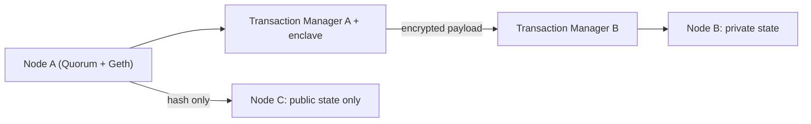

**In simple words:** Quorum un businesses ke liye Ethereum ka enterprise version hai jinhe privacy chahiye. Ise J.P. Morgan ne 2016 mein Go-Ethereum (Geth) client ke fork ke roop mein banaya aur ab ye GoQuorum ke naam se maintain hota hai. Ye **permissioned** blockchain hai: sirf approved parties join karti hain. <Cite id="corda-ripple-quorum-quorum-github" />

**Why it is needed:** public Ethereum har transaction sabko dikhata hai aur banks ke liye slow aur costly hai. Companies ko privacy, speed aur known participants chahiye, saath hi Solidity aur Ethereum tools bhi.

**Main features:**

1. **Private and public transactions.** Public wale sab nodes dekhte hain. Private transaction sirf named parties ke saath share hota hai; baaki sirf ek encrypted hash dekhte hain.
2. **Two states.** Har node ek public state (sabke liye same) aur ek private state (sirf un contracts ke liye jinmein wo hai) rakhta hai.
3. **Transaction Manager (Tessera) and enclave.** Transaction Manager private payloads ko encrypt karke sirf sahi nodes ko bhejta hai. Enclave keys rakhta hai.
4. **Pluggable consensus.** Proof of Work nahi. Options hain Raft (crash fault tolerant, fast), IBFT / QBFT (Byzantine fault tolerant) aur Clique (Proof of Authority). <Cite id="corda-ripple-quorum-quorum-ibft" />
5. **Permissioning.** Smart contracts control karte hain ki kaun se nodes join kar sakte hain.
6. **Higher throughput and no mining cost.** Fees zero ho sakti hain, aur kai sau transactions per second possible hain.

**Advantages:** privacy, speed, Ethereum compatibility. **Limits:** permissioned, isliye kam decentralised; private state complexity badhata hai. **Uses:** bank settlements, trade finance, supply chain. <Cite id="corda-ripple-quorum-gfg-quorum" />

**Conclusion:** Quorum Ethereum ke smart contracts rakhta hai par businesses ke liye privacy aur permissions jodta hai. <Cite id="corda-ripple-quorum-quorum-wp" />

Exam mein English mein likho: "Quorum is a permissioned, Ethereum-based blockchain with private transactions for enterprises."
