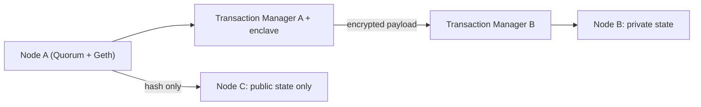

**In simple words:** Quorum is an enterprise version of Ethereum for businesses that need privacy. It was created by J.P. Morgan in 2016 as a fork of the Go-Ethereum (Geth) client and is now maintained as GoQuorum. It is a **permissioned** blockchain: only approved parties join. <Cite id="corda-ripple-quorum-quorum-github" />

**Why it is needed:** public Ethereum shows every transaction to everyone and is slow and costly for banks. Companies want privacy, speed and known participants, while still using Solidity and Ethereum tools.

**Main features:**

1. **Private and public transactions.** Public ones are seen by all nodes. A private transaction is shared only with named parties; others see just an encrypted hash.
2. **Two states.** Each node keeps a public state (same for all) and a private state (only for the contracts it takes part in).
3. **Transaction Manager (Tessera) and enclave.** The Transaction Manager encrypts and sends private payloads to the right nodes only. The enclave holds the keys.
4. **Pluggable consensus.** Not Proof of Work. Options are Raft (crash fault tolerant, fast), IBFT / QBFT (Byzantine fault tolerant) and Clique (Proof of Authority). <Cite id="corda-ripple-quorum-quorum-ibft" />
5. **Permissioning.** Smart contracts control which nodes may join.
6. **Higher throughput and no mining cost.** Fees can be zero, and many hundreds of transactions per second are possible.

**Advantages:** privacy, speed, Ethereum compatibility. **Limits:** permissioned, so less decentralised; private state adds complexity. **Uses:** bank settlements, trade finance, supply chain. <Cite id="corda-ripple-quorum-gfg-quorum" />

**Conclusion:** Quorum keeps Ethereum's smart contracts but adds privacy and permissions for businesses. <Cite id="corda-ripple-quorum-quorum-wp" />
