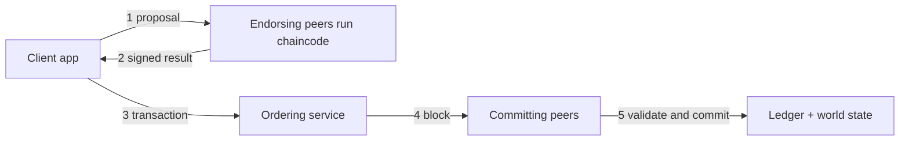

**In simple words:** Hyperledger Fabric Linux Foundation ka open-source **permissioned** blockchain framework hai, businesses ke liye. Version 1.0 (2017) ne ise redesign kiya taaki kaam alag-alag roles mein baant jaye. Iska key idea **execute - order - validate** hai, purane platforms ke "order then execute" ki jagah. <Cite id="hyperledger-fabric-whatis" />

**Components of the architecture:**

1. **Clients / application SDK:** wo app jo transactions propose karta hai.
2. **Peers:** nodes jo ledger rakhte hain. **Endorsing peers** chaincode chalate hain aur result sign karte hain; **committing peers** validate karke blocks likhte hain.
3. **Chaincode:** smart contract, Go, Java ya JavaScript mein likha, container mein chalta hai.
4. **Ordering service (orderer):** endorsed transactions leta hai, unhe ek order mein lagata hai aur blocks mein kaat deta hai. Ye chaincode nahi chalata. <Cite id="hyperledger-fabric-txflow" />
5. **Membership Service Provider (MSP) and CA:** certificates jaari karte hain, isliye har member ki known identity hoti hai.
6. **Channels:** private sub-networks. Har channel ka apna ledger hota hai, sirf uske members ko dikhta hai.
7. **Ledger:** blockchain (blocks ka log) plus **world state** (current values, LevelDB ya CouchDB mein).

**Transaction flow:**

1. Client endorsing peers ko proposal bhejta hai.
2. Peers chaincode chalate hain, abhi ledger update nahi karte, aur signed result (read-write set) lautate hain.
3. Client endorsed transaction orderer ko bhejta hai.
4. Orderer transactions ko order karke peers ko blocks bhejta hai.
5. Har peer validate karta hai (endorsement policy, koi conflicting versions nahi) aur block commit karta hai.

**Advantages:** channels se privacy, pluggable consensus, cryptocurrency ki zaroorat nahi, high speed. **Limits:** permissioned aur set up karna complex. <Cite id="hyperledger-fabric-gfg-fabric" />

**Conclusion:** Fabric v1 endorsing, ordering aur validating ko alag karke scalable, private business blockchains deta hai. <Cite id="hyperledger-fabric-androulaki-2018" />

Exam mein English mein likho: "Fabric v1 follows the execute, order, validate model with peers, an ordering service, MSP and channels."
