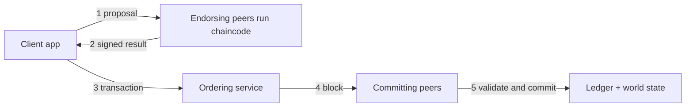

**In simple words:** Hyperledger Fabric is an open-source **permissioned** blockchain framework from the Linux Foundation, for businesses. Version 1.0 (2017) redesigned it so that work is split among different roles. Its key idea is **execute - order - validate** instead of "order then execute" used by older platforms. <Cite id="hyperledger-fabric-whatis" />

**Components of the architecture:**

1. **Clients / application SDK:** the app that proposes transactions.
2. **Peers:** nodes that hold the ledger. **Endorsing peers** run the chaincode and sign the result; **committing peers** validate and write blocks.
3. **Chaincode:** the smart contract, written in Go, Java or JavaScript, run in a container.
4. **Ordering service (orderer):** receives endorsed transactions, puts them in one order and cuts them into blocks. It does not run chaincode. <Cite id="hyperledger-fabric-txflow" />
5. **Membership Service Provider (MSP) and CA:** issue certificates, so every member has a known identity.
6. **Channels:** private sub-networks. Each channel has its own ledger, visible only to its members.
7. **Ledger:** the blockchain (log of blocks) plus the **world state** (current values, kept in LevelDB or CouchDB).

**Transaction flow:**

1. Client sends a proposal to the endorsing peers.
2. Peers run the chaincode, do not update the ledger yet, and return a signed result (read-write set).
3. Client sends the endorsed transaction to the orderer.
4. The orderer orders transactions and sends blocks to peers.
5. Each peer validates (endorsement policy, no conflicting versions) and commits the block.

**Advantages:** privacy by channels, pluggable consensus, no cryptocurrency needed, high speed. **Limits:** permissioned and complex to set up. <Cite id="hyperledger-fabric-gfg-fabric" />

**Conclusion:** Fabric v1 separates endorsing, ordering and validating to give scalable, private business blockchains. <Cite id="hyperledger-fabric-androulaki-2018" />
