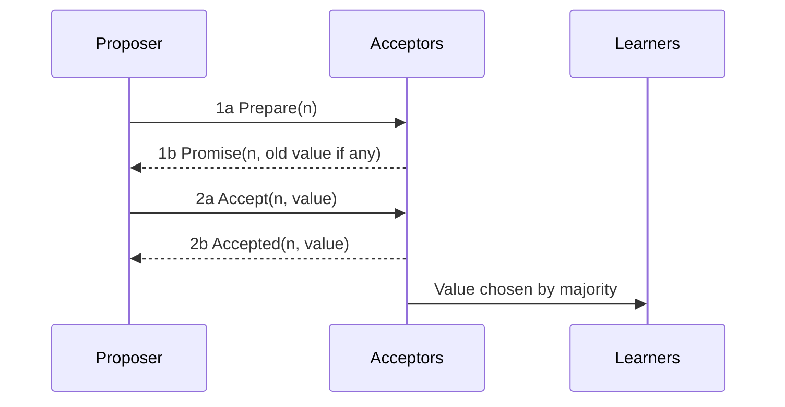

**In simple words:** Paxos Leslie Lamport ka consensus algorithm hai jo unreliable computers ke group ko ek single value pe agree karata hai, chahe kuch crash ho jaayein ya messages late aayein. Ise **majority (quorum)** ka agree hona chahiye. Ye crash faults handle karta hai, jhooth bolne wale nodes nahi. <Cite id="bft-paxos-raft-paxos-simple" />

**Roles:**

- **Proposer:** ek value suggest karta hai.
- **Acceptor:** proposals pe vote karta hai; acceptors ki majority decide karti hai.
- **Learner:** chuni hui value seekhta hai.

(Ek machine teeno roles nibha sakti hai.)

**How it works (single value, two phases):** har proposal ka ek unique, badhta hua **number n** hota hai.

1. **Phase 1a, Prepare:** proposer acceptors ko Prepare(n) bhejta hai.
2. **Phase 1b, Promise:** jis acceptor ne n se bada number nahi dekha, wo promise karta hai ki n se chhote proposals ignore karega, aur jo sabse bada proposal wo pehle accept kar chuka hai (agar koi) uska reply deta hai.
3. **Phase 2a, Accept:** agar proposer ko majority se promises mil jaayein, to wo Accept(n, value) bhejta hai. Value wahi hoti hai jo sabse bade accepted proposal se report hui, warna uski apni.
4. **Phase 2b, Accepted:** acceptor accept karta hai jab tak usne bada number promise na kiya ho, aur learners ko batata hai.
5. Jab majority accept kar le, value **chosen** ho jaati hai aur learners ko bataya jaata hai. <Cite id="bft-paxos-raft-gfg-paxos" />

**Why it is safe:** koi bhi do majorities mein kam se kam ek acceptor common hota hai, isliye baad ka proposal hamesha pehle chosen value ke baare mein jaan leta hai aur use rakhta hai. 2f+1 acceptors ke saath ye f crashes survive karta hai.

**Limits:** samajhna aur banana mushkil; do competing proposers ek doosre ko rokte reh sakte hain (livelock), jo leader elect karke theek hota hai (Multi-Paxos). Raft ek aasaan alternative ke roop mein bana. **Uses:** Google Chubby aur Spanner, aur distributed databases. <Cite id="bft-paxos-raft-wiki-paxos" />

**Conclusion:** Paxos majority ko crashes ke bawajood ek value pe safely agree karata hai. <Cite id="bft-paxos-raft-wiki-quorum" />

Exam mein English mein likho: "Paxos lets a majority of acceptors agree on a single value using prepare/promise and accept/accepted phases."
