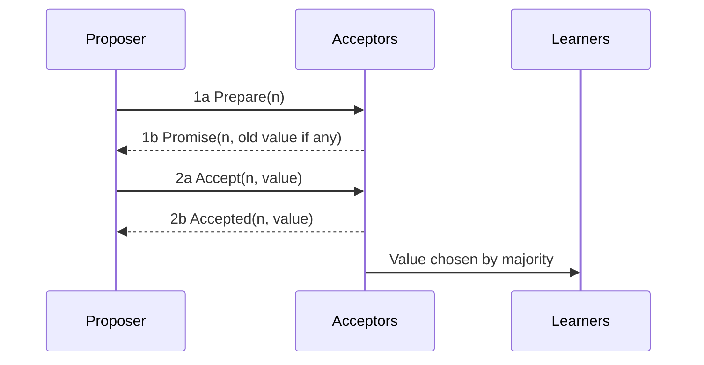

**In simple words:** Paxos is a consensus algorithm by Leslie Lamport for getting a group of unreliable computers to agree on a single value, even if some crash or messages are delayed. It needs a **majority (quorum)** to agree. It handles crash faults, not lying nodes. <Cite id="bft-paxos-raft-paxos-simple" />

**Roles:**

- **Proposer:** suggests a value.
- **Acceptor:** votes on proposals; a majority of acceptors decides.
- **Learner:** learns the chosen value.

(One machine can play all three roles.)

**How it works (single value, two phases):** each proposal has a unique, increasing **number n**.

1. **Phase 1a, Prepare:** the proposer sends Prepare(n) to the acceptors.
2. **Phase 1b, Promise:** an acceptor that has not seen a higher number promises to ignore proposals below n, and replies with the highest proposal it already accepted (if any).
3. **Phase 2a, Accept:** if the proposer gets promises from a majority, it sends Accept(n, value). The value is the one from the highest accepted proposal reported, otherwise its own.
4. **Phase 2b, Accepted:** an acceptor accepts unless it has promised a higher number, and tells the learners.
5. When a majority has accepted, the value is **chosen** and learners are told. <Cite id="bft-paxos-raft-gfg-paxos" />

**Why it is safe:** any two majorities share at least one acceptor, so a later proposal always learns about an earlier chosen value and keeps it. With 2f+1 acceptors it survives f crashes.

**Limits:** hard to understand and build; two competing proposers can keep blocking each other (livelock), fixed by electing a leader (Multi-Paxos). Raft was made as an easier alternative. **Uses:** Google Chubby and Spanner, and distributed databases. <Cite id="bft-paxos-raft-wiki-paxos" />

**Conclusion:** Paxos lets a majority agree on one value safely despite crashes. <Cite id="bft-paxos-raft-wiki-quorum" />
