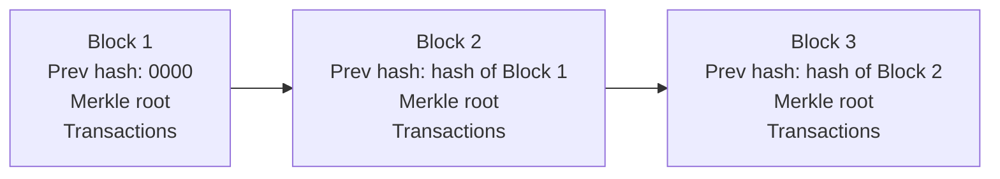

**In simple words:** blockchain ek shared notebook hai jiski copy bahut saare computers ke paas hoti hai. Nayi pages (blocks) end mein judti hain, har page pe pichhle page ka fingerprint hota hai, isliye purane page ko chupke se badla nahi ja sakta.

**Definition:** blockchain ek distributed, append-only ledger hai. Transactions blocks mein group hote hain, aur har block pichhle block se cryptographic hash se linked hota hai. Ise koi ek party control nahi karti; nodes consensus rule se agle block pe agree karte hain. <Cite id="blockchain-fundamentals-nakamoto" loc="§1-4" /> <Cite id="blockchain-fundamentals-ibm-blockchain" />

**Data structure:** blockchain do structures ko milata hai.

1. **Blocks ki linked list (hash pointers).** Har block pichhle block ke header ka hash store karta hai. Ek purana block badlo to uska hash badal jaata hai, agle block ka link toot jaata hai, aur aise aage tak.
2. **Har block ke andar Merkle tree.** Block ke saare transactions ko pairs mein hash karte hain, level by level, jab tak ek hash na bache jise Merkle root kehte hain. Ye root block header mein hota hai, isliye header saare transactions ko represent karta hai.

<Figure caption="Har block header mein pichhle block ka hash hota hai, isliye blocks ek chain banate hain. Header ka Merkle root block ke transactions ka summary hai.">

</Figure>

Block mein **header** (version, previous block hash, Merkle root, timestamp, difficulty target, nonce) aur **body** (transactions ki list) hoti hai. <Cite id="blockchain-fundamentals-gfg-structure" />

**Ye structure kyun:** tampering aasani se pakdi jaati hai, aur light client sirf header aur chhote Merkle proof se ek transaction check kar leta hai. <Cite id="block-structure-merkle-wiki-merkle" />

**Conclusion:** blockchain hash-linked blocks ki list hai, jisme har block mein transactions ka Merkle tree hota hai.
