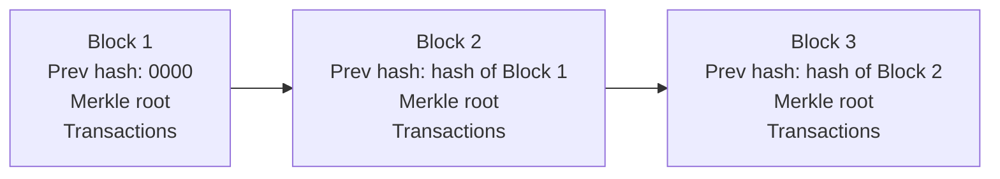

**In simple words:** a blockchain is a shared notebook that many computers keep copies of. New pages (blocks) are added at the end, each page carries a fingerprint of the page before it, so old pages cannot be changed without everybody noticing.

**Definition:** a blockchain is a distributed, append-only ledger. Transactions are grouped into blocks, and every block is linked to the previous one by a cryptographic hash. No single party controls it; the nodes agree on the next block using a consensus rule. <Cite id="blockchain-fundamentals-nakamoto" loc="§1-4" /> <Cite id="blockchain-fundamentals-ibm-blockchain" />

**Data structure used:** a blockchain combines two structures.

1. **Linked list of blocks (hash pointers).** Each block stores the hash of the previous block header. Change one old block and its hash changes, so the link in the next block breaks, and so on up the chain.
2. **Merkle tree inside each block.** All transactions of the block are hashed in pairs, level by level, up to one hash called the Merkle root. The root is stored in the block header, so the header stands for all transactions.

<Figure caption="Each block header holds the previous block's hash, so the blocks form a chain. The Merkle root inside the header summarises the block's transactions.">

</Figure>

A block has a **header** (version, previous block hash, Merkle root, timestamp, difficulty target, nonce) and a **body** (the list of transactions). <Cite id="blockchain-fundamentals-gfg-structure" />

**Why this structure:** it makes tampering easy to detect, and a light client can check one transaction with only the header and a short Merkle proof. <Cite id="block-structure-merkle-wiki-merkle" />

**Conclusion:** a blockchain is a hash-linked list of blocks, each holding a Merkle tree of transactions.
