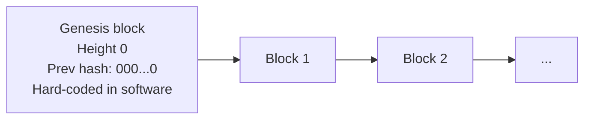

**In simple words:** genesis block blockchain ka sabse pehla block hai, "block number 0". Baaki har block iske peeche jud ta hai, jaise kitaab ka pehla page.

**Definition:** genesis block chain ka pehla block hai. Ye kisi pehle block ke upar mine nahi hota, isliye iska previous-hash field poora zeros hota hai. Ye har node ke software code mein hi likha hota hai, taaki sab nodes ek hi pehle block se shuru karein. <Cite id="block-structure-merkle-btcwiki-genesis" />

**Bitcoin ke genesis block ke facts:**

- Satoshi Nakamoto ne 3 January 2009 ko banaya; height 0.
- Isme ek hi transaction hai, coinbase jo 50 BTC reward deta hai. Ye reward spend nahi ho sakta (code ki ek quirk).
- Satoshi ne coinbase mein akhbaar ki headline daali: "The Times 03/Jan/2009 Chancellor on brink of second bailout for banks". Ye proof hai ki block pehle nahi bana, aur Bitcoin kyun bana uska hint bhi.
- Iska hash bahut saare zeros se shuru hota hai, jaisa proof-of-work chahta hai. <Cite id="block-structure-merkle-core-chainparams" />

**Kyun zaroori hai:**

1. Chain ko ek starting point chahiye jispe sab nodes agree karein.
2. Block 1 ko kisi previous hash ko point karna hota hai; genesis block ye deta hai.
3. Node kisi bhi block ko check karne ke liye peeche genesis block tak jaata hai; agar pehla block alag nikla to wo alag network hai.

<Figure caption="Genesis block akela aisa block hai jiska koi real parent nahi.">

</Figure>

**Dusri chains:** har blockchain (Ethereum, private chains) ka apna genesis block hota hai, jo genesis file mein define hota hai aur pehle accounts, balances aur settings set karta hai. <Cite id="block-structure-merkle-gfg-genesis" />

**Conclusion:** genesis block hard-coded pehla block hai jo poori chain ko anchor karta hai.
