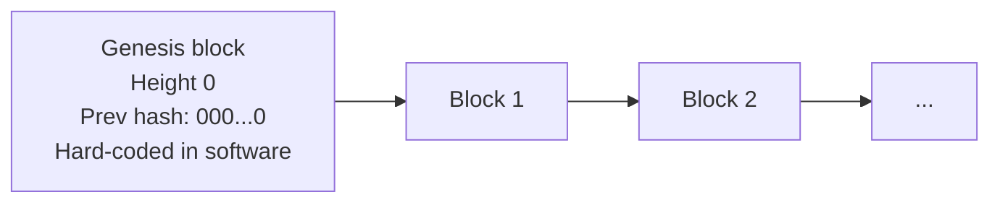

**In simple words:** the genesis block is the very first block of a blockchain, "block number 0". Every other block links back to it, like the first page of a book.

**Definition:** the genesis block is the first block of a chain. It is not created by mining on top of any earlier block, so it has no real previous block; its previous-hash field is all zeros. It is written directly into the software code of every node, so all nodes start from the same first block. <Cite id="block-structure-merkle-btcwiki-genesis" />

**Facts about Bitcoin's genesis block:**

- Created by Satoshi Nakamoto on 3 January 2009; height 0.
- It has one transaction, a coinbase paying the 50 BTC reward. This reward cannot be spent (a quirk of the code).
- Satoshi put a newspaper headline in the coinbase: "The Times 03/Jan/2009 Chancellor on brink of second bailout for banks". It proves the block was not made earlier and hints at why Bitcoin was built.
- Its hash begins with many zeros, as proof-of-work requires. <Cite id="block-structure-merkle-core-chainparams" />

**Why it is needed:**

1. A chain needs a starting point that all nodes agree on.
2. Block 1 must point to some previous hash; the genesis block gives it one.
3. A node checks any block by walking back to the genesis block; if the walk ends at a different first block, that chain is a different network.

<Figure caption="The genesis block is the only block with no real parent.">

</Figure>

**Other chains:** every blockchain (Ethereum, private chains) has its own genesis block, defined in a genesis file that sets the first accounts, balances and settings. <Cite id="block-structure-merkle-gfg-genesis" />

**Conclusion:** the genesis block is the hard-coded first block that anchors the whole chain.
