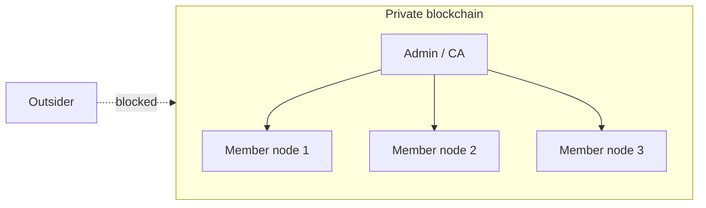

**In simple words:** private blockchain company ke internal network jaisa hai: sirf invited, known members join, read ya write kar sakte hain, aur ek organisation ise chalata hai.

**Definition:** private (permissioned) blockchain mein restrict hota hai ki kaun join, validate aur write kar sakta hai. Participants ko owner identify aur approve karta hai. <Cite id="private-blockchain-gfg-private" />

**Key characteristics:**

1. **Permissioned access.** Sirf authorised, known nodes join kar sakte hain; har ek ki identity hoti hai.
2. **Ek organisation (ya chhote group) ka control**, isliye governance centralised hai.
3. **Fast aur scalable.** Kam trusted validators, isliye consensus jaldi hota hai (hazaron transactions per second possible).
4. **Low cost, no mining.** Energy-heavy proof of work nahi; voting-style consensus jaise PBFT, Raft ya Proof of Authority.
5. **Privacy.** Data non-members se chhupa sakte hain (channels, private data).
6. **Rules badle ja sakte hain** owner dwara, aur galat data agreement se theek ho sakta hai.
7. **Kam decentralised aur kam trustless.** Participants ko owner pe kuch trust karna padta hai. <Cite id="private-blockchain-fabric-whatis" />

<Figure caption="Sirf approved members network ke andar hain; bahar wale blocked hain.">

</Figure>

| Point | Private | Public |
|---|---|---|
| Kaun join kar sakta hai | Sirf invited | Koi bhi |
| Speed | Fast | Slow |
| Consensus | PBFT, Raft, PoA | PoW, PoS |
| Privacy | High | Low (sab visible) |

<Cite id="private-blockchain-gfg-pubpriv" />

**Examples:** Hyperledger Fabric, Corda, Quorum. **Conclusion:** private chains thodi decentralisation chhod kar speed aur privacy leti hain.
