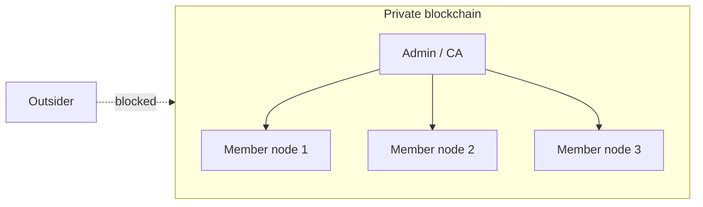

**In simple words:** a private blockchain is like a company's internal network: only invited, known members can join, read or write, and one organisation runs it.

**Definition:** a private (permissioned) blockchain restricts who may join, validate and write. Participants are identified and approved by the owner. <Cite id="private-blockchain-gfg-private" />

**Key characteristics:**

1. **Permissioned access.** Only authorised, known nodes can join; each has an identity.
2. **Controlled by one organisation** (or a small group), so governance is centralised.
3. **Fast and scalable.** Few trusted validators, so consensus is quick (thousands of transactions per second possible).
4. **Low cost and no mining.** No energy-hungry proof of work; uses voting-style consensus such as PBFT, Raft or Proof of Authority.
5. **Privacy.** Data can be hidden from non-members (channels, private data).
6. **Rules can be changed** by the owner, and bad data can be corrected by agreement.
7. **Less decentralised and less trustless.** Participants must trust the owner somewhat. <Cite id="private-blockchain-fabric-whatis" />

<Figure caption="Only approved members are inside the network; outsiders are blocked.">

</Figure>

| Point | Private | Public |
|---|---|---|
| Who can join | Invited only | Anyone |
| Speed | Fast | Slow |
| Consensus | PBFT, Raft, PoA | PoW, PoS |
| Privacy | High | Low (all visible) |

<Cite id="private-blockchain-gfg-pubpriv" />

**Examples:** Hyperledger Fabric, Corda, Quorum. **Conclusion:** private chains trade some decentralisation for speed and privacy.
