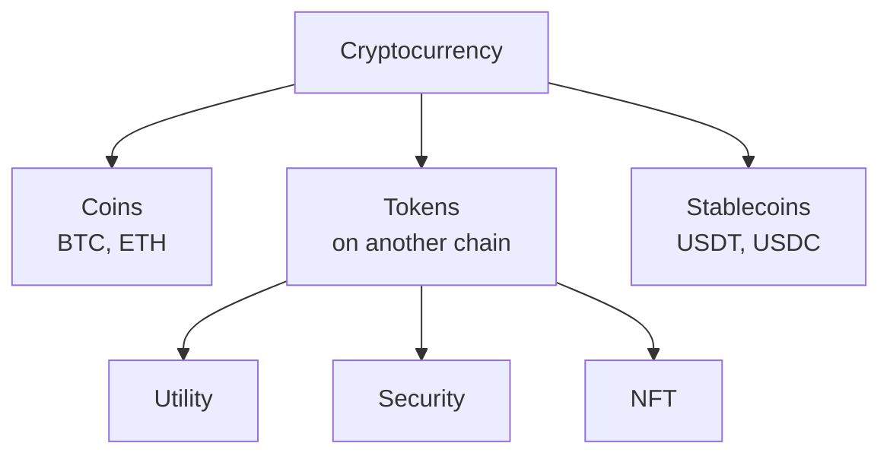

**In simple words:** cryptocurrency digital paisa hai jo blockchain pe rehta hai aur cryptography se protected hota hai. Coin kis kaam ke liye hai, uske hisaab se kai types hote hain.

**Definition:** cryptocurrency ek digital asset hai jo cryptography aur blockchain se ownership aur transfers record karta hai, bina bank ke. <Cite id="cryptocurrencies-tokens-wiki-crypto" />

**Types:**

1. **Coins (apni blockchain ki native currency).** Example: Bitcoin (BTC), Ether (ETH), Litecoin. Paisa ki tarah ya fees dene ke liye use hote hain. <Cite id="cryptocurrencies-tokens-gfg-coins-tokens" />
2. **Altcoins.** Bitcoin ke alawa koi bhi coin, jaise Litecoin aur Monero (Monero privacy pe focus karta hai).
3. **Tokens.** Dusri blockchain pe smart contracts se bante hain, jaise Ethereum pe ERC-20 tokens.
   - *Utility tokens:* kisi service ka access dete hain (jaise Basic Attention Token).
   - *Security tokens:* shares ya ownership represent karte hain aur securities law follow karte hain.
   - *Non-fungible tokens (NFTs):* har token unique hai (art, game items).
4. **Stablecoins.** Price kisi steady cheez se pegged, jaise US dollar: USDT, USDC. <Cite id="cryptocurrencies-tokens-wiki-stablecoin" />
5. **Governance tokens.** Holders vote karte hain ki project kaise chale.
6. **Central bank digital currency (CBDC).** Government ka digital paisa, jaise India ka e-rupee. Ye digital cash hai, decentralised coin nahi.

<Figure caption="Coins ki apni chain hoti hai; tokens kisi aur ki chain pe chalte hain.">

</Figure>

**Conclusion:** main split coins versus tokens hai, aur steady value ke liye stablecoins. <Cite id="cryptocurrencies-tokens-gfg-security-token" />
