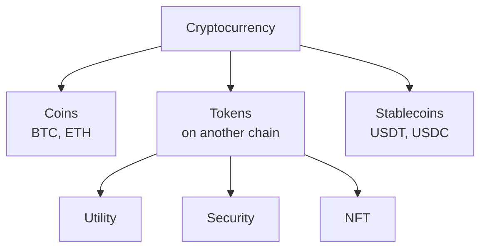

**In simple words:** a cryptocurrency is digital money that lives on a blockchain and is protected by cryptography. There are several kinds, depending on what the coin is used for.

**Definition:** a cryptocurrency is a digital asset that uses cryptography and a blockchain to record ownership and transfers without a bank. <Cite id="cryptocurrencies-tokens-wiki-crypto" />

**Types:**

1. **Coins (native currency of their own blockchain).** Example: Bitcoin (BTC), Ether (ETH), Litecoin. Used as money or to pay fees. <Cite id="cryptocurrencies-tokens-gfg-coins-tokens" />
2. **Altcoins.** Any coin other than Bitcoin, such as Litecoin and Monero (Monero focuses on privacy).
3. **Tokens.** Built on another blockchain using smart contracts, for example ERC-20 tokens on Ethereum.
   - *Utility tokens:* give access to a service (for example Basic Attention Token).
   - *Security tokens:* represent shares or ownership and follow securities law.
   - *Non-fungible tokens (NFTs):* each token is unique (art, game items).
4. **Stablecoins.** Price pegged to something steady like the US dollar, for example USDT, USDC. <Cite id="cryptocurrencies-tokens-wiki-stablecoin" />
5. **Governance tokens.** Holders vote on how a project is run.
6. **Central bank digital currency (CBDC).** Government-issued digital money, for example India's e-rupee. It is digital cash, not a decentralised coin.

<Figure caption="Coins have their own chain; tokens ride on someone else's chain.">

</Figure>

**Conclusion:** the main split is coins versus tokens, with stablecoins for steady value. <Cite id="cryptocurrencies-tokens-gfg-security-token" />
