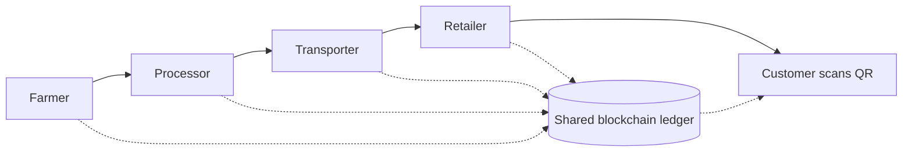

**In simple words:** supply chain matlab product ka safar, farm ya factory se dukaan tak. Blockchain is safar ka ek shared record rakhta hai jise koi chupke se badal nahi sakta.

**Aaj ki problem:** kai parties (farmer, factory, shipper, warehouse, dukaan) apne alag records rakhti hain. Isse delay, paperwork, nakli maal aur product kahan se aaya iska koi clear proof nahi hota. <Cite id="blockchain-applications-gfg-supply-revolution" />

**Blockchain kaise madad karta hai:** har handover shared ledger pe transaction ki tarah record hota hai. Sensors ya scans (barcode, RFID, IoT) jagah aur temperature jaisa data jodte hain.

**Applications:**

1. **Traceability aur provenance.** Product ko uski origin tak seconds mein trace karo. Example: Walmart ne IBM Food Trust se mangoes 2.2 seconds mein trace kiye, jabki pehle lagbhag 7 din lagte the. <Cite id="blockchain-fundamentals-ibm-blockchain" />
2. **Anti-counterfeiting.** Medicines, luxury goods aur electronics ko unique digital identity milti hai.
3. **Food safety.** Contamination hone pe sirf affected batch recall hota hai.
4. **Cold-chain monitoring.** Vaccines aur fish ka IoT temperature data store hota hai.
5. **Smart-contract payments.** Delivery confirm hote hi payment automatically release hota hai.
6. **Tez customs aur trade documents.** Example: Maersk aur IBM ka TradeLens (baad mein band ho gaya).
7. **Ethical sourcing.** Prove karo ki goods fair-trade ya conflict-free hain.

<Figure caption="Har stage same shared ledger pe likhta hai, isliye sabko same history dikhti hai.">

</Figure>

**Limits:** galat data andar gaya to galat hi nikalega (garbage in, garbage out), cost, aur saari parties ko judna padta hai. <Cite id="blockchain-applications-tp-use-cases" />

**Conclusion:** blockchain supply chains mein trust aur transparency laata hai.
