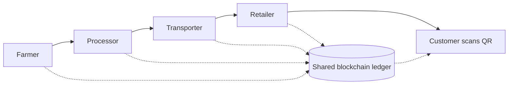

**In simple words:** a supply chain is the journey of a product from the farm or factory to the shop. Blockchain keeps one shared record of that journey that nobody can secretly change.

**Problem today:** many parties (farmer, factory, shipper, warehouse, shop) keep separate records. This leads to delays, paperwork, fake goods and no clear proof of where a product came from. <Cite id="blockchain-applications-gfg-supply-revolution" />

**How blockchain helps:** each handover is recorded as a transaction on a shared ledger. Sensors or scans (barcode, RFID, IoT) add data such as place and temperature.

**Applications:**

1. **Traceability and provenance.** Trace a product back to its origin in seconds. Example: Walmart used IBM Food Trust to trace mangoes in 2.2 seconds instead of about 7 days. <Cite id="blockchain-fundamentals-ibm-blockchain" />
2. **Anti-counterfeiting.** Medicines, luxury goods and electronics get a unique digital identity.
3. **Food safety.** On a contamination, only the affected batch is recalled.
4. **Cold-chain monitoring.** IoT temperature data is stored for vaccines and fish.
5. **Smart-contract payments.** Payment releases automatically when goods are confirmed delivered.
6. **Faster customs and trade documents.** Example: Maersk and IBM's TradeLens (later discontinued).
7. **Ethical sourcing.** Prove goods are fair-trade or conflict-free.

<Figure caption="Each stage writes to the same shared ledger, so every party sees the same history.">

</Figure>

**Limits:** bad data in (garbage in, garbage out), cost, and all parties must join. <Cite id="blockchain-applications-tp-use-cases" />

**Conclusion:** blockchain brings trust and transparency to supply chains.
