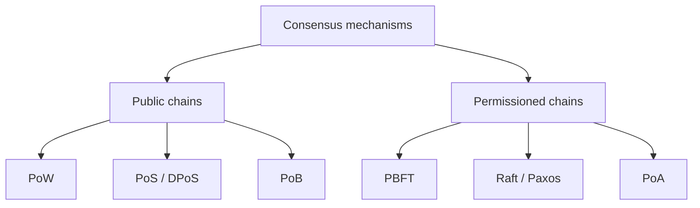

**In simple words:** blockchain mein koi boss nahi hota, isliye nodes ko ek rule chahiye ki agla block kaun sa hoga. Wahi rule consensus mechanism hai.

**Definition:** consensus mechanism ek protocol hai jisse saare honest nodes ledger ke ek hi version pe agree karte hain, chahe kuch nodes slow, offline ya dishonest hon. <Cite id="consensus-mining-gfg-consensus" />

**Types:**

1. **Proof of Work (PoW).** Miners nonce dhoondhne ki race karte hain taaki block hash target se chhota ho. Jo pehle dhoondhe wo block add karta hai aur reward pata hai. Secure hai par bahut energy lagti hai aur slow hai. Bitcoin use karta hai. <Cite id="consensus-mining-wiki-pow" />
2. **Proof of Stake (PoS).** Validators coins lock karke stake lagate hain; stake ke hisaab se ek chuna jaata hai block propose karne ke liye. Cheating pe stake katta hai ("slashing"). Kam energy. Ethereum 2022 ke Merge ke baad use karta hai. <Cite id="consensus-mining-eth-pos" />
3. **Delegated PoS (DPoS).** Coin holders chhote set ke delegates ko vote dete hain jo blocks banate hain. Fast, lekin zyada centralised (EOS).
4. **Proof of Burn (PoB).** Miners coins ko unspendable address pe bhej kar "burn" karte hain aur mining ka haq kamate hain.
5. **Proof of Authority (PoA).** Kuch approved, known validators blocks sign karte hain. Fast; private chains ke liye theek.
6. **Proof of Elapsed Time (PoET).** Har node trusted hardware ke andar random time wait karta hai; sabse chhota wait jeetta hai (Hyperledger Sawtooth).
7. **Practical Byzantine Fault Tolerance (PBFT).** Nodes rounds mein vote karte hain (pre-prepare, prepare, commit) aur n >= 3f + 1 mein se f bure nodes tolerate karte hain. Permissioned chains mein use hota hai. <Cite id="bft-paxos-raft-gfg-pbft" />
8. **Raft / Paxos.** Leader-based voting sirf crash failures ke liye (nodes jo ruk jaate hain, jhooth nahi bolte). <Cite id="bft-paxos-raft-raft-paper" />

<Figure caption="Family tab chuno jab ye pata ho ki kaun validate kar sakta hai aur kitni cheating jhelni hai.">

</Figure>

| Type | Kaun decide karta hai | Energy | Speed |
|---|---|---|---|
| PoW | Sabse zyada computing power | Bahut high | Slow |
| PoS | Sabse zyada stake | Low | Medium |
| PBFT | Known nodes ka vote | Low | Fast |

**Conclusion:** koi ek mechanism har jagah best nahi; public chains PoW ya PoS use karti hain, private chains PBFT, Raft ya PoA.
