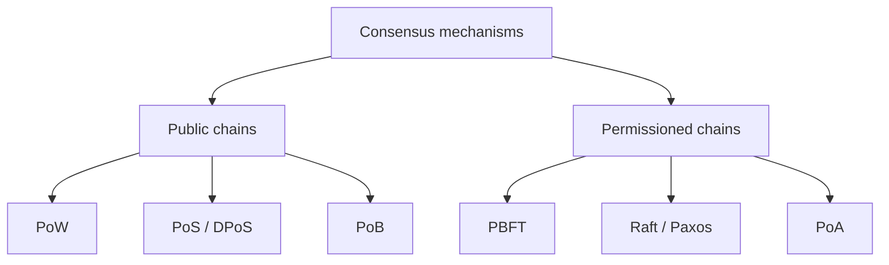

**In simple words:** in a blockchain nobody is in charge, so the nodes need a rule to agree on which block comes next. That rule is the consensus mechanism.

**Definition:** a consensus mechanism is a protocol by which all honest nodes agree on one version of the ledger even when some nodes are slow, offline or dishonest. <Cite id="consensus-mining-gfg-consensus" />

**Types:**

1. **Proof of Work (PoW).** Miners compete to find a nonce so the block hash is below a target. The first to find it adds the block and earns a reward. Secure but uses a lot of energy and is slow. Used by Bitcoin. <Cite id="consensus-mining-wiki-pow" />
2. **Proof of Stake (PoS).** Validators lock coins as a stake; one is chosen (weighted by stake) to propose a block. Cheating loses the stake ("slashing"). Low energy. Used by Ethereum since the Merge in 2022. <Cite id="consensus-mining-eth-pos" />
3. **Delegated PoS (DPoS).** Coin holders vote for a small set of delegates who produce blocks. Fast, but more centralised (EOS).
4. **Proof of Burn (PoB).** Miners burn coins by sending them to an unspendable address to earn the right to mine.
5. **Proof of Authority (PoA).** A few approved, known validators sign blocks. Fast; suited to private chains.
6. **Proof of Elapsed Time (PoET).** Each node waits a random time inside trusted hardware; the shortest wait wins (Hyperledger Sawtooth).
7. **Practical Byzantine Fault Tolerance (PBFT).** Nodes vote in rounds (pre-prepare, prepare, commit) and tolerate up to f bad nodes out of n >= 3f + 1. Used in permissioned chains. <Cite id="bft-paxos-raft-gfg-pbft" />
8. **Raft / Paxos.** Leader-based voting for crash failures only (nodes that stop, not lie). <Cite id="bft-paxos-raft-raft-paper" />

<Figure caption="Choose the family by who may validate and how much cheating you must survive.">

</Figure>

| Type | Who decides | Energy | Speed |
|---|---|---|---|
| PoW | Most computing power | Very high | Slow |
| PoS | Most stake | Low | Medium |
| PBFT | Vote of known nodes | Low | Fast |

**Conclusion:** no mechanism is best everywhere; public chains use PoW or PoS, private chains use PBFT, Raft or PoA.
