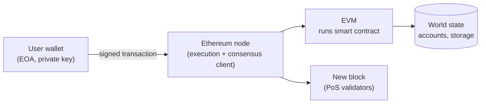

**In simple words:** Ethereum ek blockchain hai jo "world computer" bhi hai. Coins store karne ke saath ye chhote programs (smart contracts) bhi chalata hai jin pe sab agree karte hain. Ye kai parts se bana hai jo saath kaam karte hain.

**Components:**

1. **Ethereum nodes aur clients.** Computers jo Ethereum software (Geth, Nethermind) chalate hain, chain store karte hain aur blocks verify karte hain. 2022 ke baad node execution client aur consensus client dono chalata hai. <Cite id="ethereum-eth-stack" />
2. **Accounts.** Do types: *externally owned accounts (EOA)* jo private key se control hote hain, aur *contract accounts* jo code se control hote hain. Har ek ka address, balance aur nonce hota hai. <Cite id="ethereum-eth-accounts" />
3. **Ether (ETH) aur gas.** ETH native currency hai. Gas transaction ke kaam ko naapta hai; fee = gas used x gas price. <Cite id="ethereum-eth-gas" />
4. **Transactions.** EOA ke signed messages jo ETH bhejte hain, contract call karte hain ya deploy karte hain.
5. **Ethereum Virtual Machine (EVM).** Sandbox jo contract bytecode ko har node pe ek jaise chalata hai. <Cite id="ethereum-eth-evm" />
6. **Smart contracts.** Programs, aam taur pe Solidity mein, chain pe stored.
7. **State aur blocks.** World state (saare accounts) Merkle Patricia trie mein rehti hai; blocks mein transactions aur state roots hote hain.
8. **Consensus layer.** Proof of Stake validators blocks pe agree karte hain.
9. **Supporting tools.** Wallets (MetaMask), Web3 libraries, testnets, badi files ke liye IPFS/Swarm, Etherscan jaise block explorers.

<Figure caption="User transaction sign karta hai; nodes use EVM mein chalate hain aur state update karte hain.">

</Figure>

<Cite id="ethereum-gfg-components" />

**Conclusion:** accounts, ETH aur gas, EVM, smart contracts, nodes aur consensus milkar Ethereum ko programmable blockchain banate hain.
