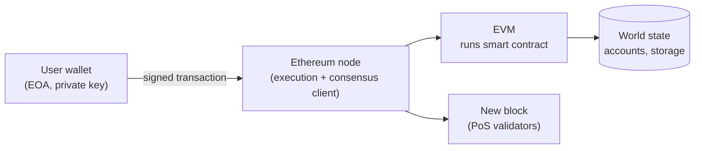

**In simple words:** Ethereum is a blockchain that is also a world computer. Besides storing coins, it can run small programs (smart contracts) that everyone agrees on. It is built from several parts that work together.

**Components:**

1. **Ethereum nodes and clients.** Computers running Ethereum software (Geth, Nethermind) that store the chain and verify blocks. Since 2022 a node runs an execution client plus a consensus client. <Cite id="ethereum-eth-stack" />
2. **Accounts.** Two types: *externally owned accounts (EOA)* controlled by a private key, and *contract accounts* controlled by code. Each has an address, a balance and a nonce. <Cite id="ethereum-eth-accounts" />
3. **Ether (ETH) and gas.** ETH is the native currency. Gas measures the work of a transaction; fee = gas used x gas price. <Cite id="ethereum-eth-gas" />
4. **Transactions.** Signed messages from an EOA that send ETH, call a contract or deploy one.
5. **Ethereum Virtual Machine (EVM).** The sandbox that runs contract bytecode the same way on every node. <Cite id="ethereum-eth-evm" />
6. **Smart contracts.** Programs, usually written in Solidity, stored on the chain.
7. **State and blocks.** The world state (all accounts) is kept in a Merkle Patricia trie; blocks carry transactions and state roots.
8. **Consensus layer.** Proof of Stake validators agree on blocks.
9. **Supporting tools.** Wallets (MetaMask), Web3 libraries, testnets, IPFS/Swarm for big files, block explorers like Etherscan.

<Figure caption="A user signs a transaction; nodes run it in the EVM and update the state.">

</Figure>

<Cite id="ethereum-gfg-components" />

**Conclusion:** accounts, ETH and gas, the EVM, smart contracts, nodes and consensus together make Ethereum a programmable blockchain.
