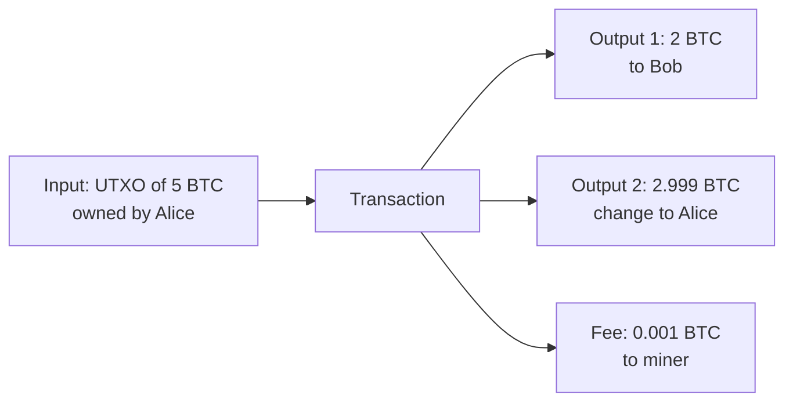

**In simple words:** UTXO ka matlab "unspent transaction output". Bitcoin account balance nahi rakhta. Wo un coins ki list rakhta hai jo abhi tak kisi ne spend nahi kiye, jaise wallet mein cash notes. Aapka balance un notes ki total value hai jinhe aap unlock kar sakte ho.

**UTXO model:**

1. Har transaction mein **inputs** (purane UTXOs jo spend ho rahe hain) aur **outputs** (naye UTXOs jo ban rahe hain) hote hain.
2. UTXO poora spend hota hai. Agar aapke paas 5 BTC ka note hai aur 2 BTC dene hain, to 5 spend hota hai aur do outputs bante hain: 2 receiver ko, aur lagbhag 3 wapas aapko **change** ke roop mein (chhota difference miner fee hai).
3. Total inputs = total outputs + fee.
4. Har UTXO sirf ek baar use hota hai; spend hone ke baad wo UTXO set se nikal jaata hai. <Cite id="wallets-utxo-double-spending-gfg-utxo" />

<Figure caption="Input destroy hota hai; outputs naye hain. Change sender ko wapas jaata hai.">

</Figure>

**Double spending:** ek hi coin do baar kharch karna, jaise ek hi UTXO se do dukaanon ko paisa dena. Digital files copy karna aasan hai, isliye ise rokna zaroori hai. <Cite id="wallets-utxo-double-spending-btcwiki-double-spending" />

**Bitcoin ise kaise rokta hai:**

1. **UTXO check.** Har node check karta hai ki har input UTXO set mein hai. Agar pehle hi spend ho chuka hai, transaction reject.
2. **Public ledger.** Saare transactions network pe broadcast hote hain, isliye sabko pehla spend dikhta hai.
3. **Proof of work aur blocks.** Transactions blocks mein order hote hain. Sirf ek chain jeetti hai; conflicting dusra spend gir jaata hai.
4. **Confirmations.** Lagbhag 6 blocks wait karne se reversal bahut mehenga ho jaata hai, kyunki attacker ko 50% se zyada hash power chahiye. <Cite id="blockchain-fundamentals-nakamoto" loc="§11" />
5. **Digital signatures** dusron ko aapke coins spend karne se rokte hain.

<Cite id="wallets-utxo-double-spending-gfg-prevent-double" />

**Conclusion:** UTXO set aur public, ordered, proof-of-work chain ka matlab hai ki coin sirf ek baar spend ho sakta hai.
