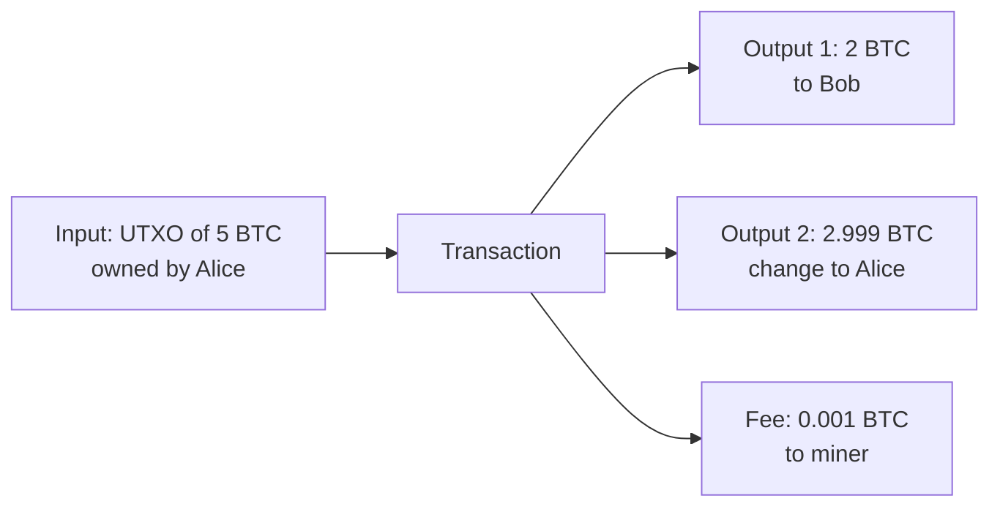

**In simple words:** UTXO means "unspent transaction output". Bitcoin does not keep account balances. It keeps a list of coins that nobody has spent yet, like cash notes in your wallet. Your balance is the total value of the notes you can unlock.

**UTXO model:**

1. Every transaction has **inputs** (old UTXOs being spent) and **outputs** (new UTXOs created).
2. A UTXO is spent whole. If you hold a 5 BTC note and pay 2 BTC, you spend the 5 and create two outputs: 2 to the receiver and about 3 back to yourself as **change** (the small difference is the miner fee).
3. Total inputs = total outputs + fee.
4. Each UTXO can be used once; after spending it leaves the UTXO set. <Cite id="wallets-utxo-double-spending-gfg-utxo" />

<Figure caption="Input is destroyed; outputs are new. Change goes back to the sender.">

</Figure>

**Double spending:** spending the same coin twice, for example paying two shops with the same UTXO. With digital files, copying is easy, so this must be stopped. <Cite id="wallets-utxo-double-spending-btcwiki-double-spending" />

**How Bitcoin solves it:**

1. **UTXO check.** Every node checks that each input is in the UTXO set. If it was already spent, the transaction is rejected.
2. **Public ledger.** All transactions are broadcast to the network, so everyone sees the first spend.
3. **Proof of work and blocks.** Transactions are ordered inside blocks. Only one chain wins; a conflicting second spend is dropped.
4. **Confirmations.** Waiting for about 6 blocks makes reversal very costly, since an attacker would need over 50% of the hash power. <Cite id="blockchain-fundamentals-nakamoto" loc="§11" />
5. **Digital signatures** stop others from spending your coins.

<Cite id="wallets-utxo-double-spending-gfg-prevent-double" />

**Conclusion:** the UTXO set plus a public, ordered, proof-of-work chain means a coin can be spent only once.
