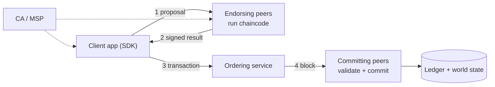

**In simple words:** Hyperledger Fabric businesses ke liye permissioned blockchain hai. Har node sab kaam karne ke bajaye, kaam baanta jaata hai: kuch nodes contracts chalate hain, kuch transactions ko order karte hain, aur kuch result store karte hain.

**Definition:** Fabric Linux Foundation ke under open-source enterprise blockchain hai. Members certificates se pehchane jaate hain, aur smart contracts ko chaincode kehte hain. <Cite id="hyperledger-fabric-whatis" />

**Main components:**

1. **Peers.** Ledger store karte hain aur chaincode chalate hain. *Endorsing peers* transaction simulate karke sign karte hain; *committing peers* validated blocks likhte hain.
2. **Ordering service (orderers).** Transactions ko ek total order mein rakhta hai aur blocks banata hai (current versions mein Raft). Orderers chaincode nahi chalate.
3. **Membership Service Provider (MSP) aur Certificate Authority (CA).** Identities issue aur check karte hain.
4. **Channels.** Private sub-networks, har ek ka apna ledger, isliye channel ke members hi uska data dekhte hain.
5. **Ledger.** *Blockchain* (blocks ka immutable log) plus *world state* (current key-value data, LevelDB ya CouchDB mein).
6. **Chaincode.** Business logic jo Go, Java ya JavaScript mein likhi hoti hai, container mein chalti hai.
7. **Endorsement policy.** Batati hai kaun se organisations sign karein (jaise "Org1 AND Org2"). <Cite id="hyperledger-fabric-network" />
8. **Client application / SDK.** Peers ko proposals bhejta hai.

**Execute-order-validate flow:** client endorsing peers ko proposal bhejta hai, jo chaincode chalakar signed result lautate hain; client endorsements orderer ko bhejta hai; orderer block banata hai; peers validate karke commit karte hain. <Cite id="hyperledger-fabric-txflow" />

<Figure caption="Pehle endorse, phir order, phir validate aur commit.">

</Figure>

**Advantages:** privacy, high speed, pluggable consensus, cryptocurrency ki zaroorat nahi. **Disadvantage:** zyada complex aur kam decentralised. <Cite id="hyperledger-fabric-gfg-fabric" />

**Conclusion:** Fabric ka modular design (peers, orderers, channels, MSP) enterprise use ke liye fit hai. Ref: <Cite id="hyperledger-fabric-androulaki-2018" />
