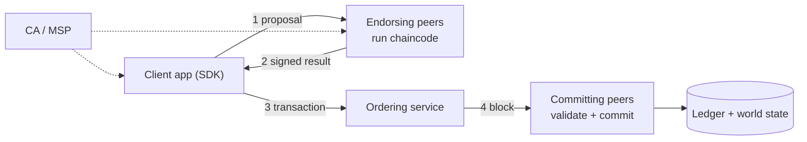

**In simple words:** Hyperledger Fabric is a permissioned blockchain for businesses. Instead of every node doing every job, the work is split: some nodes run the contracts, others order the transactions, and others store the result.

**Definition:** Fabric is an open-source enterprise blockchain under the Linux Foundation. Members are known through certificates, and smart contracts are called chaincode. <Cite id="hyperledger-fabric-whatis" />

**Main components:**

1. **Peers.** Store the ledger and run chaincode. *Endorsing peers* simulate and sign a transaction; *committing peers* write validated blocks.
2. **Ordering service (orderers).** Puts transactions into a total order and cuts them into blocks (Raft in current versions). Orderers do not run chaincode.
3. **Membership Service Provider (MSP) and Certificate Authority (CA).** Issue and check identities.
4. **Channels.** Private sub-networks, each with its own ledger, so only members of a channel see its data.
5. **Ledger.** The *blockchain* (immutable log of blocks) plus the *world state* (current key-value data, in LevelDB or CouchDB).
6. **Chaincode.** Business logic written in Go, Java or JavaScript, run in a container.
7. **Endorsement policy.** Says which organisations must sign (for example "Org1 AND Org2"). <Cite id="hyperledger-fabric-network" />
8. **Client application / SDK.** Sends proposals to peers.

**Execute-order-validate flow:** the client sends a proposal to endorsing peers, which run the chaincode and return signed results; the client sends the endorsements to the orderer; the orderer makes a block; peers validate and commit it. <Cite id="hyperledger-fabric-txflow" />

<Figure caption="Endorse first, then order, then validate and commit.">

</Figure>

**Advantages:** privacy, high speed, pluggable consensus, no cryptocurrency needed. **Disadvantage:** more complex and less decentralised. <Cite id="hyperledger-fabric-gfg-fabric" />

**Conclusion:** Fabric's modular design (peers, orderers, channels, MSP) suits enterprise use. Ref: <Cite id="hyperledger-fabric-androulaki-2018" />
