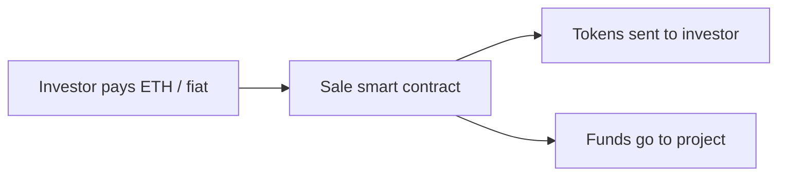

**In simple words:** ERC20 aur ERC721 Ethereum pe tokens banane ke rulebooks hain. ICO aur STO naye tokens bechkar paisa jutane ke do tareeke hain.

**ERC20 (fungible token standard):**

- Har token identical aur interchangeable hota hai, jaise rupee ke notes.
- Required functions: `totalSupply`, `balanceOf`, `transfer`, `approve`, `allowance`, `transferFrom`; events `Transfer` aur `Approval`.
- Sab tokens same interface follow karte hain, isliye wallets aur exchanges unhe automatically support karte hain.
- Examples: USDT, USDC, LINK. <Cite id="cryptocurrencies-tokens-eip20" />

**ERC721 (non-fungible token, NFT):**

- Har token ka unique `tokenId` aur owner hota hai, isliye do tokens same nahi hote, jaise zameen ke deeds.
- Functions: `ownerOf`, `balanceOf`, `transferFrom`, `safeTransferFrom`, `approve`, `getApproved`; metadata image ya data ko point karta hai.
- Digital art, game items, tickets, certificates ke liye use hota hai. Examples: CryptoKitties, Bored Apes. <Cite id="cryptocurrencies-tokens-eip721" />

| Point | ERC20 | ERC721 |
|---|---|---|
| Token type | Fungible | Non-fungible |
| Identity | Sab same | Unique tokenId |
| Divisible | Haan | Nahi |
| Use | Currency, utility | Collectibles, deeds |

<Cite id="cryptocurrencies-tokens-gfg-erc-vs" />

**ICO (Initial Coin Offering):** start-up naye bane tokens public ko bechta hai, aam taur pe ETH ya BTC ke badle, product ready hone se pehle funds jutane ke liye. Steps: whitepaper publish karo, token contract banao, sale chalao, exchanges pe list karo. IPO jaisa lekin regulation kam, isliye bahut scams hue (risk: koi legal protection nahi). <Cite id="cryptocurrencies-tokens-gfg-ico" />

**STO (Security Token Offering):** aise tokens jo asli ownership (shares, bonds, real estate, profit rights) represent karte hain aur securities law follow karte hain. Investors KYC/AML checks se guzarte hain, aur issuer regulated hota hai. ICO se safer. <Cite id="cryptocurrencies-tokens-gfg-security-token" />

| Point | ICO | STO |
|---|---|---|
| Token kis par based | Aam taur pe kuch nahi, ya utility | Real asset ya share |
| Regulation | Kam | Poora securities law |
| Investor checks | Aksar nahi | KYC/AML |
| Risk | High | Kam |

<Figure caption="Dono sales tokens issue karti hain; STO mein legal backing add hoti hai.">

</Figure>

**Conclusion:** ERC20 aur ERC721 batate hain token kya hai; ICO aur STO batate hain wo kaise becha jaata hai.
