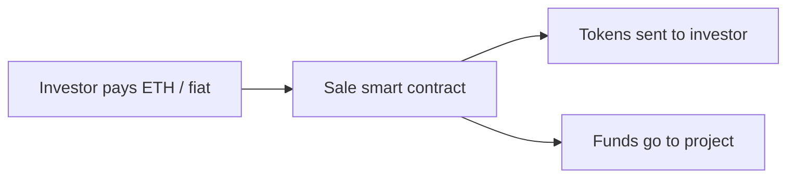

**In simple words:** ERC20 and ERC721 are rulebooks for making tokens on Ethereum. ICO and STO are two ways of selling new tokens to raise money.

**ERC20 (fungible token standard):**

- Every token is identical and interchangeable, like rupee notes.
- Required functions: `totalSupply`, `balanceOf`, `transfer`, `approve`, `allowance`, `transferFrom`; events `Transfer` and `Approval`.
- Because all tokens follow the same interface, wallets and exchanges support them automatically.
- Examples: USDT, USDC, LINK. <Cite id="cryptocurrencies-tokens-eip20" />

**ERC721 (non-fungible token, NFT):**

- Each token has a unique `tokenId` and an owner, so no two are the same, like land deeds.
- Functions: `ownerOf`, `balanceOf`, `transferFrom`, `safeTransferFrom`, `approve`, `getApproved`; metadata points to image or data.
- Used for digital art, game items, tickets, certificates. Examples: CryptoKitties, Bored Apes. <Cite id="cryptocurrencies-tokens-eip721" />

| Point | ERC20 | ERC721 |
|---|---|---|
| Token type | Fungible | Non-fungible |
| Identity | All same | Unique tokenId |
| Divisible | Yes | No |
| Use | Currency, utility | Collectibles, deeds |

<Cite id="cryptocurrencies-tokens-gfg-erc-vs" />

**ICO (Initial Coin Offering):** a start-up sells newly created tokens to the public, usually for ETH or BTC, to raise funds before the product is ready. Steps: publish a whitepaper, build the token contract, run the sale, list on exchanges. Like an IPO but with little regulation, so many scams happened (risk: no legal protection). <Cite id="cryptocurrencies-tokens-gfg-ico" />

**STO (Security Token Offering):** tokens that represent real ownership (shares, bonds, real estate, profit rights) and obey securities law. Investors go through KYC/AML checks, and the issuer is regulated. It is safer than an ICO. <Cite id="cryptocurrencies-tokens-gfg-security-token" />

| Point | ICO | STO |
|---|---|---|
| Token backs | Usually nothing, or utility | Real asset or share |
| Regulation | Little | Full securities law |
| Investor checks | Often none | KYC/AML |
| Risk | High | Lower |

<Figure caption="Both sales issue tokens; the STO adds legal backing.">

</Figure>

**Conclusion:** ERC20 and ERC721 define what a token is; ICO and STO define how it is sold.
