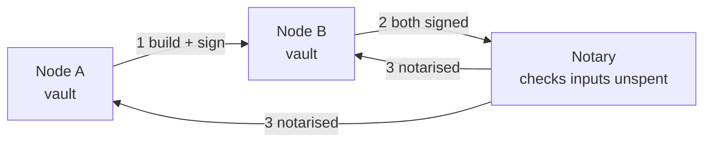

**In simple words:** Corda banks ke liye bani blockchain hai. Zyadatar chains ki tarah ye har transaction sabko nahi bhejti. Sirf involved parties dekhti hain, aur ek notary double spending rokta hai.

**Corda architecture:**

1. **Nodes.** Har organisation apna node chalati hai jisme uska apna vault (database) hota hai. Koi global ledger nahi; har node sirf wahi facts rakhta hai jinka wo party hai.
2. **States.** Kisi fact ka immutable record (jaise Rs 10 lakh ka loan). State tab "spent" hoti hai jab koi transaction use karti hai; ye UTXO jaisa hai.
3. **Contracts.** Code jo check karta hai ki transaction valid hai (JVM pe Java/Kotlin). Ye legal prose se juda hota hai.
4. **Flows.** Step-by-step protocols jisme nodes signatures collect karte hain aur transactions seedhe peer to peer share karte hain.
5. **Notary.** Ek service (single node ya Raft/BFT cluster) jo check karti hai ki koi input state pehle spend nahi hui. Ye uniqueness consensus deti hai.
6. **Network map aur Doorman.** Permissioned network ke liye identity aur node directory.
7. **Oracles** bahar ke facts dete hain jaise exchange rates. <Cite id="corda-ripple-quorum-corda-intro-wp" /> <Cite id="corda-ripple-quorum-corda-tech-wp" />

<Figure caption="Deal sirf Bank A aur Bank B dekhte hain; notary sirf utna dekhta hai jitna double spending rokne ke liye zaroori hai.">

</Figure>

<Cite id="corda-ripple-quorum-xoriant-corda" />

**Quorum:** Ethereum ka fork (JPMorgan ne banaya, ab ConsenSys) private use ke liye. Ye *private transactions* add karta hai jo privacy manager (Tessera) handle karta hai, aur mining ki jagah IBFT/Raft/QBFT consensus use karta hai. Solidity aur EVM support karta hai. <Cite id="corda-ripple-quorum-quorum-github" />

**Comparison:**

| Point | Corda | Quorum |
|---|---|---|
| Base | Scratch se bana | Ethereum (Geth) ka fork |
| Data sharing | Sirf involved parties | Saare nodes, private txs Tessera se |
| Ledger | Global ledger nahi; per-node vaults | Ek shared chain |
| Smart contracts | Java/Kotlin | Solidity (EVM) |
| Consensus | Notary (uniqueness) | IBFT, QBFT ya Raft |
| Model | UTXO jaisi states | Account-based |
| Focus | Finance, legal agreements | General enterprise |

<Cite id="corda-ripple-quorum-gfg-quorum" />

**Conclusion:** Corda data need-to-know basis pe share karta hai; Quorum Ethereum ke tools rakhta hai aur privacy add karta hai.
