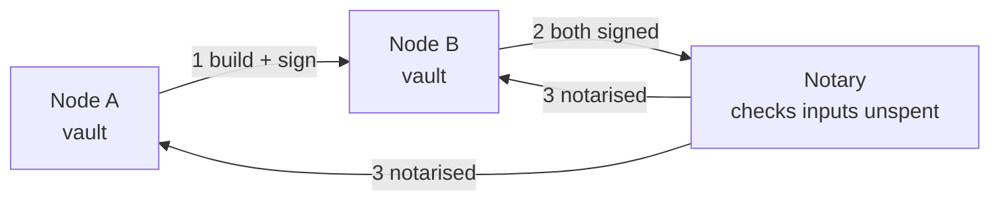

**In simple words:** Corda is a blockchain built for banks. Unlike most chains, it does not send every transaction to everybody. Only the parties involved see it, and a notary stops double spending.

**Corda architecture:**

1. **Nodes.** Each organisation runs a node with its own vault (database). There is no global ledger; each node holds only the facts it is party to.
2. **States.** An immutable record of a fact (for example a loan of Rs 10 lakh). A state is "spent" when a transaction uses it; this is like a UTXO.
3. **Contracts.** Code that checks a transaction is valid (Java/Kotlin on the JVM). They are tied to legal prose.
4. **Flows.** Step-by-step protocols in which nodes collect signatures and share transactions directly, peer to peer.
5. **Notary.** A service (single node or a cluster using Raft or BFT) that checks no input state was spent before. It gives uniqueness consensus.
6. **Network map and Doorman.** Identity and node directory for the permissioned network.
7. **Oracles** supply outside facts such as exchange rates. <Cite id="corda-ripple-quorum-corda-intro-wp" /> <Cite id="corda-ripple-quorum-corda-tech-wp" />

<Figure caption="Only Bank A and Bank B see the deal; the notary sees only what is needed to stop double spending.">

</Figure>

<Cite id="corda-ripple-quorum-xoriant-corda" />

**Quorum:** an Ethereum fork (by JPMorgan, now ConsenSys) for private use. It adds *private transactions* handled by a privacy manager (Tessera), and uses IBFT/Raft/QBFT consensus instead of mining. It supports Solidity and the EVM. <Cite id="corda-ripple-quorum-quorum-github" />

**Comparison:**

| Point | Corda | Quorum |
|---|---|---|
| Base | Built from scratch | Fork of Ethereum (Geth) |
| Data sharing | Only involved parties | All nodes, private txs via Tessera |
| Ledger | No global ledger; per-node vaults | One shared chain |
| Smart contracts | Java/Kotlin | Solidity (EVM) |
| Consensus | Notary (uniqueness) | IBFT, QBFT or Raft |
| Model | UTXO-like states | Account-based |
| Focus | Finance, legal agreements | General enterprise |

<Cite id="corda-ripple-quorum-gfg-quorum" />

**Conclusion:** Corda shares data on a need-to-know basis; Quorum keeps Ethereum tools and adds privacy.
